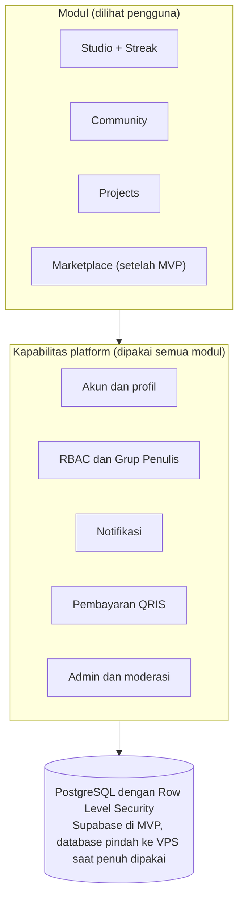
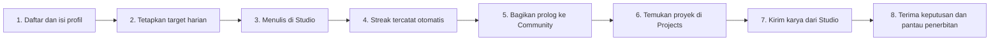
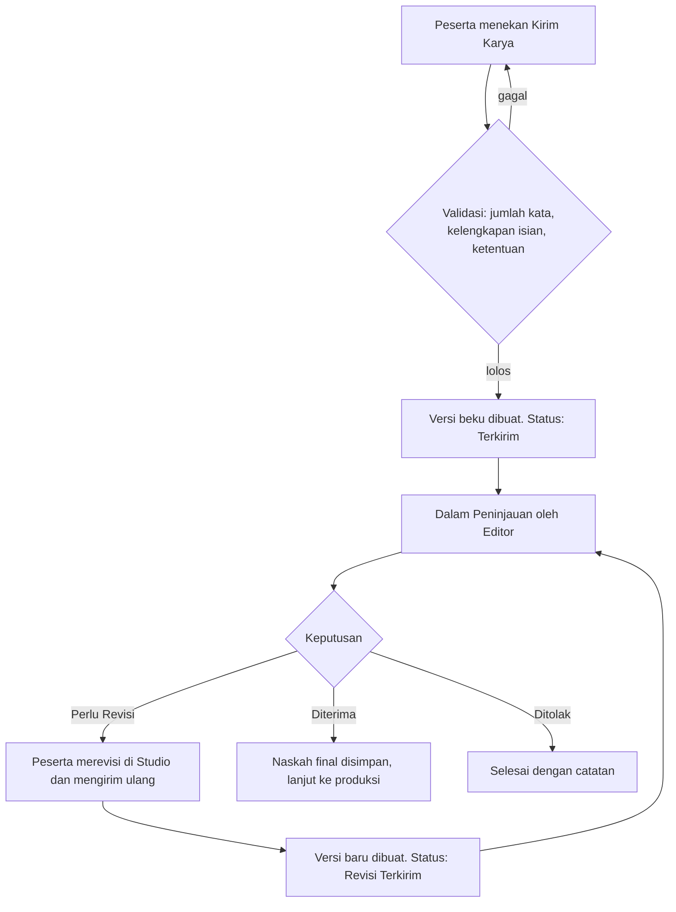
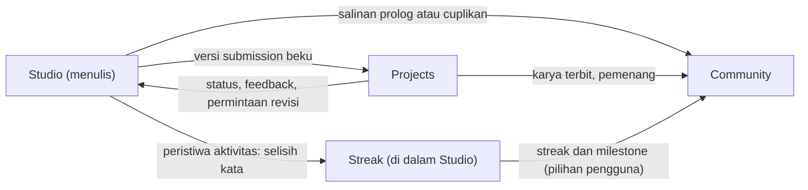

# PRD RanahMenulis

Versi 0.2, revisi 9 November 2026 · Penyusun: Aditya Imam Zuhdi (v0.1: 7 November 2026; v0.2: 8 November 2026)

## 1. Ringkasan Produk

RanahMenulis adalah aplikasi web responsif yang mengantar seseorang dari menulis satu paragraf sampai menerbitkan buku, dalam satu akun dan satu alur data, untuk pengguna di Indonesia dan Malaysia.

| Atribut | Keterangan |
| --- | --- |
| Nama produk | RanahMenulis |
| Jenis produk | Ekosistem digital untuk menulis, komunitas literasi, pendidikan menulis, dan penerbitan buku |
| Platform | Aplikasi web responsif (desktop, tablet, smartphone). Aplikasi Android dan iOS untuk Play Store dan App Store dibungkus dari versi web setelah web stabil; waktunya mengikuti Q-40 |
| Target pasar | Indonesia dan Malaysia |
| Teknologi terencana | Next.js dalam satu proyek (monolith untuk tampilan dan backend), TypeScript, Tailwind CSS, shadcn/ui; Supabase (PostgreSQL, Auth, Storage) untuk MVP, dengan rencana memindahkan database (bukan login) ke VPS saat sudah penuh dipakai (bagian 19.3). Pembayaran QRIS memakai layanan sendiri di VPS kecil sejak MVP (bagian 19.2) |
| Status dokumen | Draf v0.2, revisi 9 November 2026, untuk ditinjau founder. Memuat keputusan diskusi lanjutan dan rapat 8 November 2026 (Streak menyatu dengan Studio, Grup Penulis, Marketplace setelah MVP, Next.js monolith dengan Supabase, dan rencana migrasi ke VPS), serta revisi 9 November 2026: tingkat Super Admin yang memberikan role Administrator, grup dibuat Administrator dengan lebih dari satu admin grup (penulis kini boleh membuat grup sendiri: BR-COM-12, Q-57), dan logo grup di Fase 2. Belum ada kode atau implementasi |

Produk memiliki **tiga modul inti**. Ranah Streak kini menjadi bagian dari Ranah Studio. Marketplace ditambahkan setelah MVP. Modul lain tidak ditambah tanpa persetujuan founder.

| Modul | Peran dalam perjalanan penulis | Satu kalimat |
| --- | --- | --- |
| Ranah Studio (termasuk Streak) | Menulis dan kebiasaan | Ruang kerja pribadi untuk menulis, menyimpan, dan mengelola karya; aktivitas menulis langsung dicatat sebagai Streak |
| Ranah Community | Pembaca | Jaringan sosial penulis untuk membagikan dan menemukan karya |
| Projects | Peluang | Pusat Antologi, Solo, Kelas Menulis, dan Lomba |
| Marketplace (setelah MVP) | Transaksi | Jual-beli karya atau buku hasil lomba dan penerbitan, terpisah dari Community; rincian belum ditentukan (Q-39) |

Catatan penting: registrasi, profil, notifikasi, pembayaran, dan administrasi bukan modul kelima. Semuanya adalah **kapabilitas platform** yang melayani modul di atas (lihat bagian 7).

Konvensi dokumen: rujukan seperti **(Q-19)** menandai keputusan yang belum diberikan founder; nomornya mengarah ke daftar di bagian 28. **Usulan** menandai rekomendasi tim produk yang belum final.

Riwayat perubahan dari v0.1 ada di [CHANGELOG](prd/CHANGELOG.md).

## 2. Visi dan Misi

**Visi.** RanahMenulis adalah platform digital yang membantu setiap orang menemukan suara mereka melalui tulisan, mengembangkan kemampuan menulis, membangun kebiasaan menulis, terhubung dengan pembaca dan penulis lain, serta mengubah karya mereka menjadi buku yang diterbitkan.

**Misi.** "Membantu setiap orang menemukan suaranya, mengembangkan kemampuan menulis, terhubung dengan pembaca, dan mengubah kata-kata menjadi buku yang diterbitkan."

**Filosofi produk.** RanahMenulis bukan aplikasi pengetik dokumen. Ia adalah tempat seseorang memulai perjalanan sebagai penulis: dari satu paragraf, kebiasaan, karya yang dibagikan, pembaca, proyek penerbitan, bimbingan mentor, sampai buku terbit.

Prinsip turunan yang menjadi pegangan keputusan desain dan teknis:

- **Satu perjalanan, bukan empat aplikasi.** Setiap modul berbagi identitas pengguna, data karya, dan alur kerja dengan modul lain.
- **Penulis memegang karyanya.** Hak cipta dilindungi; dokumen pribadi tidak pernah menjadi publik secara otomatis.
- **Fokus pada kebutuhan penulis.** Studio sengaja tidak meniru Microsoft Word.
- **Identitas literasi.** Terasa seperti platform buku dan penerbitan, bukan dasbor SaaS generik dan bukan media sosial umum.

## 3. Tujuan Bisnis

Tujuan bisnis RanahMenulis adalah membangun basis penulis aktif yang terus kembali menulis, lalu mengubah sebagian dari mereka menjadi peserta program berbayar (penerbitan, kelas, lomba). Angka target belum diberikan founder, sehingga kolom target dibiarkan sebagai keputusan.

| Tujuan | Mengapa penting | Indikator (definisi di bagian 25) | Target |
| --- | --- | --- | --- |
| Membangun kebiasaan menulis | Pengguna yang menulis rutin lebih mungkin berinteraksi, ikut program, dan menerbitkan | Pengguna aktif menulis mingguan; panjang streak | (Q-36) |
| Membangun komunitas literasi | Pembaca dan apresiasi memberi alasan menulis dan mengikuti program | Karya dipublikasikan; apresiasi dan komentar per karya | (Q-36) |
| Menghubungkan penulis dengan peluang penerbitan | Inilah sumber pendapatan utama | Pendaftar program; submission yang selesai | (Q-36) |
| Mencapai pendapatan awal dari Projects | Membuktikan model bisnis | Jumlah peserta berbayar; pendapatan per kategori | (Q-36) |
| Menjadi platform tepercaya di dua negara | Target pasar Indonesia dan Malaysia | Pengguna aktif per negara | (Q-36) |

Sumber pendapatan potensial dan urutan peluncurannya dibahas di bagian 22. Tidak semua model harus diluncurkan bersamaan.

## 4. Target Pengguna

Segmen di bawah diturunkan dari brief founder dan berstatus hipotesis sampai divalidasi lewat riset pengguna. Data demografi (usia, profesi, jumlah) belum tersedia dan tidak diasumsikan di sini.

| Segmen | Siapa mereka | Yang dicari di RanahMenulis | Modul yang paling dipakai | Role |
| --- | --- | --- | --- | --- |
| Penulis pemula | Ingin mulai menulis tetapi belum punya kebiasaan atau pembaca | Tempat menulis yang nyaman, target harian, pembaca pertama, kelas | Studio, Streak, Kelas | Registered User, Writer |
| Penulis aktif | Sudah rutin menulis dan ingin dibaca | Audiens, apresiasi, portofolio | Studio, Community | Writer |
| Calon penulis buku | Punya naskah atau tema dan ingin terbit | Antologi atau Solo, status penerbitan yang transparan | Studio, Projects | Writer |
| Peserta lomba dan kelas | Ingin mengasah kemampuan dan mendapat pengakuan | Lomba, tugas, feedback mentor, sertifikat | Projects | Writer |
| Pembaca | Menikmati tulisan orang lain tanpa harus menulis | Menemukan karya bagus, menyimpan, mengapresiasi | Community | Guest, Registered User |
| Penyelenggara dan tim editorial | Mengelola proyek, menyeleksi, menyunting, mentoring, menjuri | Alat kerja yang rapi untuk submission dan penilaian | Projects (sisi pengelola) | Project Organizer, Editor, Judge/Mentor |
| Tim platform | Menjaga mutu dan keamanan | Moderasi, kurasi, pengelolaan pengguna dan grup; pemberian role Administrator (Super Admin) | Seluruh platform | Administrator, Super Admin |

Pasar Indonesia dan Malaysia berimplikasi pada bahasa, mata uang (Rupiah dan Ringgit), zona waktu, dan regulasi data. Rinciannya ada di bagian 11, 21, dan 22.

## 5. Permasalahan yang Ingin Diselesaikan

Permasalahan berikut disimpulkan dari visi dan fitur yang diminta founder. Semuanya hipotesis yang perlu diuji lewat wawancara pengguna sebelum desain final.

| No | Permasalahan | Dampak bagi penulis | Dijawab oleh |
| --- | --- | --- | --- |
| P1 | Sulit menjaga kebiasaan menulis tanpa ukuran dan pengingat yang jelas | Tulisan berhenti di tengah jalan | Ranah Streak |
| P2 | Alat menulis umum terlalu rumit atau tidak dirancang untuk penulis | Fokus terpecah, naskah tersebar di banyak tempat | Ranah Studio |
| P3 | Penulis pemula sulit menemukan pembaca dan umpan balik | Kehilangan motivasi | Ranah Community |
| P4 | Media sosial umum tidak menghargai tulisan panjang dan tidak memberi identitas literasi | Karya tenggelam di antara konten lain | Ranah Community |
| P5 | Proses penerbitan buku tidak transparan dan tidak terhubung dengan karya yang sudah ada | Penulis tidak tahu status naskahnya, harus mengirim ulang berkas | Projects (Antologi, Solo) dan Studio |
| P6 | Kelas dan lomba menulis tersebar di banyak kanal tanpa rekam jejak terpadu | Sulit menilai kemajuan dan membangun portofolio | Projects (Kelas Menulis, Lomba) |
| P7 | Kekhawatiran atas hak cipta ketika mengirim karya ke pihak lain | Ragu mengikuti program | Aturan hak cipta dan versi submission yang tidak berubah |
| P8 | Penulis di Indonesia dan Malaysia belum punya satu tempat bersama | Pasar terfragmentasi | Platform dua negara dengan Rupiah dan Ringgit |

## 6. Solusi Produk

RanahMenulis menjawab permasalahan di atas dengan satu ekosistem yang menyatukan kebiasaan, ruang kerja, komunitas, dan peluang penerbitan.

| Permasalahan | Solusi | Bagaimana hubungannya antarmodul |
| --- | --- | --- |
| P1 Kebiasaan | Target harian, kalender, streak, milestone | Setiap kata baru yang ditulis di Studio otomatis masuk ke Streak |
| P2 Alat menulis | Editor bersih, simpan otomatis, folder, manuskrip | Dokumen Studio menjadi sumber untuk Community dan Projects |
| P3, P4 Pembaca dan identitas | Feed, Apresiasi, Highlight, Discover, kartu tulisan | Karya dibagikan dari Studio; profil menampilkan streak dan portofolio |
| P5 Penerbitan | Antologi dan Solo dengan status yang terlacak di dasbor | Naskah diambil dari Studio sebagai versi submission yang dibekukan |
| P6 Belajar dan kompetisi | Kelas Menulis dan Lomba dengan tugas, penilaian, sertifikat | Tugas dan karya lomba dikirim dari Studio; hasil masuk portofolio |
| P7 Hak cipta | Ketentuan wajib disetujui sebelum mendaftar; hak penulis dinyatakan jelas | Versi submission tidak berubah ketika dokumen asli diedit |
| P8 Dua negara | Penanda negara, zona waktu pengguna, dukungan IDR dan MYR | Discover memiliki kategori Indonesia Writers dan Malaysia Writers |

Pengalaman inti yang harus terasa mulus: **menulis di Studio, tercatat di Streak, dibagikan ke Community, lalu menemukan dan mengikuti proyek di Projects.** Alur lengkap ada di bagian 13 dan 18.

## 7. Struktur Keseluruhan Aplikasi

Aplikasi terdiri dari tiga modul inti (Studio dengan Streak di dalamnya, Community, dan Projects), ditambah Marketplace setelah MVP, di atas satu lapisan kapabilitas platform dan satu basis data. Aplikasi dibangun sebagai satu proyek Next.js; basis data memakai Supabase di MVP dan dipindah ke VPS saat sudah penuh dipakai.

Modul menjadi lapisan produk yang dilihat pengguna; kapabilitas platform melayani semua modul; seluruh data berada di satu PostgreSQL dengan Row Level Security.

**Pembagian peran lapisan.**

| Lapisan | Isi | Aturan |
| --- | --- | --- |
| Modul | Ranah Studio (termasuk Streak), Ranah Community, Projects; Marketplace setelah MVP | Tiga modul inti di MVP; Marketplace menyusul. Modul lain tidak ditambah tanpa persetujuan founder |
| Kapabilitas platform | Akun dan profil, RBAC dan Grup Penulis, notifikasi, pembayaran, admin dan moderasi | Dipakai bersama; bukan modul dan tidak muncul sebagai produk tersendiri |
| Data dan penyimpanan | PostgreSQL, Auth, Storage di Supabase (MVP); setelah migrasi hanya PostgreSQL yang pindah ke VPS, login tetap di Supabase Auth (bagian 19.3) | Skema modular per domain, tetapi satu identitas pengguna dan relasi lintas modul |

**Prinsip arsitektur.**

- **Modular:** setiap modul memiliki domain data dan logikanya sendiri, berkomunikasi lewat antarmuka dan peristiwa yang jelas (bagian 19).
- **Satu identitas:** semua modul memakai akun dan profil yang sama.
- **Hak akses di basis data:** aturan RBAC, termasuk izin Grup Penulis, ditegakkan lewat Row Level Security, bukan hanya di antarmuka.
- **Monolith:** tampilan dan backend berada dalam satu proyek Next.js dan satu deploy, supaya mudah dirawat tim kecil. Dipecah hanya bila memang diperlukan.
- **Mudah dipindah:** akses data lewat satu lapisan di server, skema lewat berkas migrasi, serta penyimpanan file lewat lapisan tipis (login tetap di Supabase Auth), supaya database dapat dipindah dari Supabase ke VPS tanpa menulis ulang fitur (bagian 19.3).
- **Teknologi:** Next.js, TypeScript, Tailwind CSS, shadcn/ui, dan Supabase untuk MVP, sesuai keputusan founder. Rincian skema dan pustaka pendukung ditentukan pada fase desain teknis.

## 8. Penjelasan Detail Modul

Setiap modul dijelaskan dengan format yang sama: tujuan, pengguna, cara kerja, data, kondisi berhasil dan gagal, hubungan dengan modul lain, batasan akses, dan contoh nyata. Daftar fitur ada di bagian 9, kebutuhan fungsional rinci di bagian 10.

Studio dan Streak adalah **satu modul** dengan satu navigasi dan satu alur data: Streak dihitung dari aktivitas menulis di Studio. Bagiannya tetap dipisah menjadi dua area (8.1, 9.2, 10.2, 14.1, 17.3 untuk Streak; 8.2, 9.3, 10.3, 14.2, 17.2 untuk Menulis) agar aturan masing-masing mudah dibaca, dan nomor bagian dipertahankan agar rujukan tidak putus. ID fitur STK dan STD tetap dipakai. Marketplace dan Grup Penulis dibahas di bagian 7, 15.4, dan 23.

### 8.1 Studio, area Streak

| Aspek | Penjelasan |
| --- | --- |
| Tujuan | Membantu pengguna menulis secara konsisten dan melihat perkembangan produktivitasnya |
| Pengguna | Registered User dan Writer. Guest tidak memakai Streak |
| Cara kerja | Pengguna menetapkan target kata per hari. Saat menulis di Studio, Studio mengirim **perubahan kata** (selisih, bukan hitung ulang seluruh dokumen) ke Streak. Streak menjumlahkannya per hari menurut zona waktu pengguna, membandingkan dengan target, lalu memperbarui streak, kalender, statistik, dan milestone |
| Data | Target harian, zona waktu, catatan aktivitas menulis (tanggal lokal, dokumen, kata ditambahkan, kata dihapus), total harian, panjang streak, milestone yang diraih |
| Berhasil | Total kata hari itu mencapai target sehingga hari ditandai selesai dan streak bertambah satu |
| Gagal atau tepi | Target tidak tercapai sampai pergantian hari sehingga streak putus. Koneksi terputus: aktivitas dikirim ulang setelah tersambung. Salin-tempel teks besar: tunduk pada aturan keaslian aktivitas (bagian 14) |
| Hubungan modul | Sumber data dari Studio; hasilnya tampil di profil Community; kartu pencapaian dibagikan ke media sosial |
| Akses | Setiap pengguna hanya melihat data Streak miliknya. Yang tampil publik di profil hanya bila pengguna memilih menampilkannya (Q-45) |
| Contoh | Dewi menetapkan 300 kata per hari. Ia menulis 320 kata di dokumen "Bab 1". Progres harian menjadi 106 persen, hari ditandai selesai, streak naik dari 6 menjadi 7, dan milestone "7 Hari Berturut-turut" terbuka dengan tombol Bagikan |

### 8.2 Studio, area Menulis

| Aspek | Penjelasan |
| --- | --- |
| Tujuan | Ruang kerja utama untuk menulis, menyimpan, mengedit, dan mengelola seluruh karya, dengan pengalaman yang bersih dan profesional |
| Pengguna | Registered User dan Writer. Premium Member bila ada batas yang berbeda (Q-02) |
| Kit inspirasi dan bantuan | Tab atau drawer bantuan di dalam editor. Isinya kit inspirasi: ide cerita, kalimat pembuka, kamus diksi, pertanyaan refleksi, ide judul, kalimat penutup, dan kamus transisi, ditambah perpustakaan prompt siap salin untuk ChatGPT atau Claude. Tab bantuan juga menjelaskan bagian yang sedang dibuka bila pengguna bingung (rapat 8 November 2026) |
| Fitur dari Penulis+ | Editor, penghitung kata, Blueprint 10 Hari, dan fitur lain dari Penulis+ dibawa ke Studio. Di rapat, founder menyebut word counter dan blueprint dibawa; daftar akhir fitur yang dibawa dikonfirmasi ulang sebelum desain Studio |
| Cara kerja | Pengguna membuat dokumen, menulis dengan pemformatan terbatas (bold, italic, heading, paragraf, blockquote, daftar), dan sistem menyimpan otomatis. Dokumen disusun dalam folder atau digabung menjadi manuskrip. Dari dokumen, pengguna dapat membagikan ke Community, mengirim ke Projects, atau mengekspor |
| Data | Dokumen (isi, judul, folder, tanggal ubah, jumlah kata), folder, manuskrip dan urutan bab, template, status simpan |
| Berhasil | Setiap ketikan tersimpan tanpa tindakan manual; status penyimpanan terlihat; data tidak hilang saat pindah halaman |
| Gagal atau tepi | Internet terputus: perubahan ditahan di perangkat dan disinkronkan ulang. Dokumen diubah di dua perangkat: konflik dideteksi dan pengguna diminta memilih. Dokumen dihapus: masuk ke sampah sebelum hapus permanen (Q-12) |
| Hubungan modul | Mengirim perubahan kata ke Streak; menjadi sumber karya untuk Community; menjadi sumber submission untuk Projects |
| Akses | Dokumen bersifat pribadi. Tidak pernah publik secara otomatis walau dipakai untuk fitur lain |
| Contoh | Raka membuat manuskrip "Arutala" berisi Bab 1 sampai 3, Catatan, dan Riset. Ia mengetik di Bab 2 di kereta; sinyal hilang; status berubah menjadi "Belum tersinkron"; sinyal kembali dan status menjadi "Tersimpan" tanpa kehilangan teks |

### 8.3 Ranah Community

| Aspek | Penjelasan |
| --- | --- |
| Tujuan | Jaringan sosial khusus penulis untuk membagikan gambaran karya yang sedang ditulis, membaca postingan penulis lain, menemukan penulis baru, mendapat apresiasi, dan membangun audiens |
| Pengguna | Guest (membaca konten publik), Registered User dan Writer (berinteraksi dan membuat postingan), Administrator (moderasi dan kurasi) |
| Cara kerja | Di MVP, Community berupa postingan. Penulis menceritakan apa yang sedang ia tulis lewat prolog atau cuplikan karya, yang ditulis langsung atau dipilih dari dokumen Studio, lalu mengaturnya sebagai publik. Sistem membuat **salinan publik** dari teks yang dipilih saja; dokumen pribadi tetap terpisah dan karya penuh tidak dibagikan. Pembaca menemukan postingan lewat Feed dan Discover, lalu memberi Apresiasi, komentar, bookmark, atau mengikuti penulis. Tidak ada pesan langsung (DM) atau chat pribadi di tahap awal. Publikasi karya penuh (tulisan pendek dan panjang), cerita berseri, Highlight, dan kartu tulisan menyusul di Fase 2 (COM-12) |
| Data | Postingan (prolog atau cuplikan, tanggal, status), apresiasi, komentar, bookmark, relasi follow, profil dan portofolio, laporan moderasi. Fase 2 menambah karya penuh, highlight, dan kartu tulisan |
| Berhasil | Postingan tampil di feed dan profil penulis, bisa diapresiasi dan dikomentari, dan tautan postingan bisa dibagikan |
| Gagal atau tepi | Postingan melebihi batas kata ditolak dengan pesan jelas. Komentar dilaporkan: masuk antrean moderasi. Postingan ditarik penulis: hilang dari feed, dengan nasib komentar dan hitungan mengikuti aturan bisnis bagian 14 |
| Hubungan modul | Teks postingan dapat dipilih dari Studio; profil menampilkan data Streak dan hasil Projects (misalnya karya antologi, pemenang lomba) bila pengguna mengizinkan |
| Akses | Konten publik dapat dibaca Guest. Berinteraksi memerlukan akun. Penulis hanya mengubah dan menghapus karya serta komentarnya sendiri |
| Contoh | Sari menulis puisi di Studio, lalu membagikan prolog tiga baris ke Community sebagai postingan publik. Pembaca memberi 48 Apresiasi dan satu komentar. Puisi lengkapnya tetap pribadi sampai karya penuh dibuka di Fase 2 |

### 8.4 Projects

Projects hanya memiliki empat kategori. Alur kerja tiap kategori berbeda, tetapi fondasinya sama: katalog, detail, pendaftaran, pengiriman, status, dan keputusan.

| Aspek | Penjelasan |
| --- | --- |
| Tujuan | Pusat program, kesempatan, dan kegiatan untuk mengembangkan kemampuan menulis, berkolaborasi, berkompetisi, dan menerbitkan buku |
| Pengguna | Writer dan Registered User (peserta); Project Organizer, Editor, Judge/Mentor (pengelola); Administrator |
| Cara kerja bersama | Organizer membuat proyek dalam salah satu dari empat kategori dan mempublikasikannya. Peserta membaca ketentuan, menyetujui syarat hak cipta, mendaftar (dan membayar bila berbayar), lalu mengirim karya atau tugas. Setiap pengiriman menyimpan **versi beku** dari dokumen Studio. Pengelola meninjau, menilai, atau memberi feedback sesuai kategori. Peserta memantau status di dasbornya |
| Data | Proyek, kategori, ketentuan, biaya (per mata uang), kuota, jadwal, pendaftaran, pembayaran, submission dan versinya, penugasan editor atau juri, feedback, penilaian, keputusan, status produksi |
| Berhasil | Peserta mendapat kejelasan status di setiap tahap dan keputusan akhir yang tercatat |
| Gagal atau tepi | Kuota penuh atau deadline lewat: pendaftaran dan pengiriman ditutup. Naskah tidak memenuhi syarat: validasi menolak dengan alasan. Pembayaran belum terkonfirmasi: pendaftaran belum aktif |
| Hubungan modul | Mengambil karya dari Studio; hasil seperti pemenang dan karya terbit dapat tampil di profil Community; mengirim notifikasi |
| Akses | Organizer hanya mengelola proyek yang ditugaskan; Editor hanya submission yang ditugaskan; Judge hanya karya yang ditugaskan |

| Kategori | Untuk siapa dan apa | Ciri khas alur |
| --- | --- | --- |
| Antologi | Beberapa penulis dalam satu buku bertema, contoh "Antologi: Surat yang Tidak Pernah Terkirim" | Seleksi, feedback editor, revisi, persetujuan, lalu penyuntingan, layout, produksi |
| Solo | Penulis menerbitkan satu buku sendiri (novel, puisi, memoar, esai, nonfiksi, kumpulan cerpen) | Paket layanan, pengajuan, editing, proofreading, cover, layout, persetujuan final, produksi, dasbor status |
| Kelas Menulis | Kelas, workshop, pelatihan, dan mentoring (creative writing, puisi, novel, akademik, copywriting, storytelling, esai) | Kurikulum, jadwal, materi, tugas, feedback mentor, progres, sertifikat |
| Lomba | Kompetisi menulis (puisi, cerpen, esai, artikel, microfiction, storytelling) | Deadline, penjurian berkriteria, penilaian anonim opsional, finalis, pemenang, sertifikat |

## 9. Daftar Fitur Setiap Modul

Setiap fitur memiliki ID yang dipakai di seluruh dokumen (kebutuhan fungsional, user stories, acceptance criteria). Kolom Fase adalah **usulan** yang mengikuti prioritas founder: tiga modul inti wajib ada di MVP, sementara alur lanjutan boleh menyusul. Persetujuan fase ada di bagian 23 dan 28.

### 9.1 Kapabilitas platform (bukan modul)

| ID | Fitur | Pengguna utama | Fase |
| --- | --- | --- | --- |
| PLT-01 | Registrasi, login, verifikasi email, reset kata sandi | Semua | MVP |
| PLT-02 | Profil dan pengaturan akun (nama, username, foto, bio, negara, zona waktu, genre) | Registered User | MVP |
| PLT-03 | Role-Based Access Control, tingkat Super Admin, dan penugasan per proyek dan per grup | Super Admin, Administrator | MVP |
| PLT-04 | Notifikasi dalam aplikasi dan email transaksional | Semua | MVP |
| PLT-05 | Panel administrasi dasar (pengguna, role, grup, proyek, konten, audit log) | Super Admin, Administrator | MVP |
| PLT-06 | Moderasi dan penanganan laporan | Administrator | MVP |
| PLT-07 | Pembayaran: informasi biaya, pembayaran QRIS (konfirmasi lewat webhook; awalnya semi-manual dengan dashboard admin), dan konfirmasi manual | Peserta, Organizer | MVP (Q-19) |
| PLT-08 | Pembayaran online MYR dan gateway resmi lintas mata uang | Peserta | Fase 2 |
| PLT-09 | Logo grup: Admin Grup atau Administrator mengunggah gambar sebagai logo Grup Penulis | Admin Grup, Administrator | Fase 2 |
| PLT-10 | Dashboard di Beranda: blok ringkasan "Hari ini" di atas feed (lanjutkan menulis, progres harian, hal yang perlu perhatian, proyek saya, notifikasi baru, ringkasan mingguan, tiga angka kata, kartu panduan awal yang bisa ditutup, kartu proyek dan kelas yang sedang dibuka) | Registered User ke atas | MVP (sementara, ditinjau ulang setelah desain; Q-49) |
| PLT-11 | Pengaturan notifikasi, email progres menulis mingguan, dan notifikasi penyemangat sederhana saat menulis | Registered User ke atas | MVP (keputusan client 17 November 2026) |
| PLT-12 | Satu tautan komunitas luar resmi (Discord atau WhatsApp) tempat percakapan diarahkan, pengganti chat realtime | Semua | MVP (keputusan client 17 November 2026) |

### 9.2 Studio, area Streak

| ID | Fitur | Pengguna utama | Fase |
| --- | --- | --- | --- |
| STK-01 | Target menulis harian (dialog dengan pilihan cepat; harian saja, tanpa target mingguan) | Writer | MVP |
| STK-02 | Pelacakan jumlah kata (berbasis perubahan) | Writer | MVP |
| STK-03 | Kalender aktivitas menulis | Writer | MVP |
| STK-04 | Penghitungan streak | Writer | MVP |
| STK-05 | Statistik harian, mingguan, bulanan, ditambah tiga angka kata (minggu, bulan, tahun ini) | Writer | MVP (dasar) |
| STK-06 | Pencapaian atau milestone | Writer | MVP (daftar dasar) |
| STK-07 | Kartu pencapaian yang dapat dibagikan | Writer | Fase 2 |
| STK-08 | Target per dokumen: target kata dan tenggat, boleh lebih dari satu per dokumen | Writer | MVP (keputusan client 17 November 2026) |
| STK-09 | Riwayat streak sebelumnya | Writer | MVP (keputusan client 17 November 2026) |
| STK-10 | Kartu progres yang dapat dibagikan | Writer | MVP (keputusan client 17 November 2026) |

### 9.3 Studio, area Menulis

| ID | Fitur | Pengguna utama | Fase |
| --- | --- | --- | --- |
| STD-01 | Editor tulisan (bold, italic, heading, paragraf, blockquote, bullet, numbered list) | Writer | MVP |
| STD-02 | Penyimpanan otomatis, status simpan, penanganan offline, penanganan konflik | Writer | MVP |
| STD-03 | Pengelolaan dokumen dan folder (buat, ubah nama, pindah, hapus, cari, urutkan) | Writer | MVP |
| STD-04 | Penghitung kata, karakter, paragraf | Writer | MVP |
| STD-05 | Template menulis | Writer | Fase 2 |
| STD-06 | Pengelolaan manuskrip (gabungan dokumen menjadi proyek buku) | Writer | Fase 2 (Q-11) |
| STD-07 | Ekspor TXT dan PDF | Writer | MVP (Q-46) |
| STD-08 | Ekspor DOCX | Writer | Fase 2 |
| STD-09 | Kirim dokumen ke Projects sebagai versi submission | Writer | MVP |
| STD-10 | Bagikan prolog atau cuplikan dokumen ke Community | Writer | MVP |
| STD-11 | Kit inspirasi dan tab bantuan di dalam editor (ide cerita, kalimat pembuka, kamus diksi, pertanyaan refleksi, ide judul, kalimat penutup, kamus transisi, perpustakaan prompt) | Writer | MVP |
| STD-12 | Riwayat versi tulisan, disimpan 3 hari | Writer | MVP (keputusan client 17 November 2026) |
| STD-13 | Timer sprint pribadi di editor | Writer | MVP (keputusan client 17 November 2026) |
| STD-14 | Pencarian cepat dan pencarian di daftar dokumen | Writer | MVP (keputusan client 17 November 2026) |
| STD-15 | Arsip dan duplikat dokumen | Writer | MVP (keputusan client 17 November 2026) |
| STD-16 | Jenis dokumen dan tag | Writer | MVP (keputusan client 17 November 2026) |
| STD-17 | Pengaturan menulis di akun dan daftar pintasan keyboard | Writer | MVP (keputusan client 17 November 2026) |
| STD-18 | Angka kata yang dapat disematkan di editor | Writer | MVP (keputusan client 17 November 2026) |
| STD-19 | Gambar kutipan untuk dibagikan | Writer | MVP (keputusan client 17 November 2026) |
| STD-20 | Impor naskah dari Word (.docx saja) | Writer | Fase 2 (keputusan client 17 November 2026) |

### 9.4 Ranah Community

| ID | Fitur | Pengguna utama | Fase |
| --- | --- | --- | --- |
| COM-01 | Postingan prolog atau cuplikan karya (diatur publik oleh penulis) | Writer | MVP |
| COM-02 | Cerita berseri | Writer | Fase 2 |
| COM-03 | Feed | Semua | MVP |
| COM-04 | Apresiasi | Registered User | MVP |
| COM-05 | Komentar (tulis, balas, hapus milik sendiri, laporkan) | Registered User | MVP |
| COM-06 | Bookmark | Registered User | MVP |
| COM-07 | Highlight ("This Line Hit Me") | Registered User | Fase 2 (Q-15) |
| COM-08 | Follow penulis | Registered User | MVP |
| COM-09 | Discover | Semua | MVP (kategori dasar) |
| COM-10 | Profil penulis publik dan portofolio | Semua | MVP |
| COM-11 | Kartu tulisan yang dapat dibagikan | Writer | Fase 2 |
| COM-12 | Publikasi karya penuh (tulisan pendek dan tulisan panjang) | Writer | Fase 2 (Q-14) |
| COM-13 | Event: fitur umum (tantangan menulis bersama; tantangan pertama jadi contoh), tampil sebagai daftar kartu, peserta hanya berupa jumlah | Semua | MVP (keputusan client 17 November 2026) |
| COM-14 | Berbagi progres ke grup sebagai pilihan terpisah, dengan peringatan privasi | Anggota Grup | MVP (keputusan client 17 November 2026) |

### 9.5 Projects

| ID | Fitur | Kategori | Pengguna utama | Fase |
| --- | --- | --- | --- | --- |
| PRJ-01 | Daftar dan halaman detail proyek | Semua | Semua | MVP |
| PRJ-02 | Ketentuan, persetujuan hak cipta, dan pendaftaran peserta | Semua | Writer | MVP |
| PRJ-03 | Pengelolaan proyek oleh Organizer (buat, jadwal, kuota, publikasi, penugasan) | Semua | Project Organizer | MVP |
| PRJ-04 | Pengiriman karya dan status submission | Antologi, Solo, Lomba | Writer | MVP |
| PRJ-05 | Pemesanan buku | Antologi, Solo | Pembeli | Fase 3 (Q-25) |
| ANT-01 | Seleksi, feedback editor, permintaan revisi, persetujuan karya | Antologi | Editor | MVP |
| ANT-02 | Pelacakan penyuntingan, desain, layout, produksi, penerbitan | Antologi | Organizer | MVP (status manual) |
| SOL-01 | Daftar paket, detail layanan, harga, persyaratan, pengajuan penerbitan | Solo | Writer | MVP |
| SOL-02 | Dasbor perkembangan penerbitan (editing, proofreading, cover, layout, persetujuan final, produksi) | Solo | Writer | MVP (status manual) |
| KLS-01 | Kurikulum, materi, jadwal, profil pengajar | Kelas Menulis | Writer | MVP |
| KLS-02 | Dasbor peserta dan progres belajar | Kelas Menulis | Writer | MVP |
| KLS-03 | Tugas, pengumpulan tugas, feedback mentor | Kelas Menulis | Writer, Mentor | MVP |
| KLS-04 | Sertifikat kelas | Kelas Menulis | Writer | Fase 2 |
| LMB-01 | Kriteria dan sistem penilaian juri (termasuk anonim) | Lomba | Judge | MVP |
| LMB-02 | Pengumuman finalis dan pemenang | Lomba | Semua | MVP |
| LMB-03 | Sertifikat lomba | Lomba | Pemenang, peserta | Fase 2 |
| PRJ-06 | Pembatalan pendaftaran oleh peserta, hanya untuk proyek gratis | Semua | Writer | MVP (keputusan client 17 November 2026) |
| KLS-05 | Bagian "Kelas yang sedang berjalan" dengan tombol Lanjutkan | Kelas Menulis | Writer | MVP (keputusan client 17 November 2026) |
| KLS-06 | Salin latihan menulis dari kelas ke Studio | Kelas Menulis | Writer | MVP (keputusan client 17 November 2026) |
| KLS-07 | Testimoni peserta di halaman kelas | Kelas Menulis | Semua | MVP (keputusan client 17 November 2026) |

## 10. Kebutuhan Fungsional Setiap Fitur

Kolom "Pemicu dan perilaku sistem" menjelaskan apa yang terjadi saat pengguna bertindak. Kolom "Data" menyebut data inti yang disimpan. Kolom "Gagal dan kasus tepi" menyebut kondisi tidak normal yang harus ditangani. Batasan akses per role ada di bagian 15.

### 10.1 Kapabilitas platform

| ID | Pemicu dan perilaku sistem | Data | Gagal dan kasus tepi |
| --- | --- | --- | --- |
| PLT-01 | Pengguna mendaftar dengan email dan kata sandi; sistem mengirim email verifikasi; akun aktif penuh setelah verifikasi. Login, logout, dan reset kata sandi tersedia. Setiap akun baru otomatis berperan Registered User; peran lain tidak dapat dipilih saat mendaftar. Metode login sosial: Q-05 | Email, hash kata sandi (dikelola Supabase Auth), status verifikasi, waktu daftar | Email sudah terdaftar; tautan verifikasi kedaluwarsa (kirim ulang); kata sandi lemah ditolak; percobaan login berulang dibatasi |
| PLT-02 | Pengguna melengkapi profil: nama, username unik, foto, bio, negara (Indonesia atau Malaysia), zona waktu, genre. Zona waktu terisi otomatis dari perangkat dan dapat diubah | Profil, username, negara, zona waktu, pengaturan privasi | Username dipakai orang lain; foto melebihi ukuran; perubahan zona waktu memengaruhi perhitungan streak (aturan di bagian 14) |
| PLT-03 | Sistem memeriksa role dan penugasan pada setiap aksi yang dilindungi, di antarmuka maupun di basis data. Role Administrator dan Super Admin hanya dapat diberikan atau dicabut oleh Super Admin. Administrator, Super Admin, atau penulis (BR-COM-12, Q-57) membuat grup, mengundang anggota, dan menunjuk Admin Grup (satu grup boleh lebih dari satu Admin Grup; aturan di bagian 15.4) | Role, penugasan per proyek, submission, atau grup | Pengguna tanpa hak mendapat pesan akses ditolak; Administrator yang mencoba memberi role Administrator ditolak; pencabutan Super Admin terakhir ditolak; perubahan role dicatat di audit log |
| PLT-04 | Peristiwa penting (lihat bagian 20) membuat notifikasi dalam aplikasi dan, bila berlaku, email. Pengguna mengatur preferensi | Notifikasi, status baca, preferensi | Email gagal terkirim (coba ulang); notifikasi duplikat dicegah |
| PLT-05 | Administrator mengelola pengguna (di bawah tingkat Administrator), grup, proyek, konten yang dikurasi, dan melihat audit log. Super Admin memiliki semua wewenang itu, ditambah memberi dan mencabut role Administrator dan mengubah pengaturan tingkat sistem | Audit log (siapa, apa, kapan) | Tindakan sensitif memerlukan konfirmasi; tidak ada pengguna, termasuk Super Admin, yang dapat mengubah atau menghapus log |
| PLT-06 | Pengguna melaporkan karya atau komentar; laporan masuk antrean; admin memutuskan (abaikan, sembunyikan, hapus, tindak pada akun) | Laporan, alasan, status, keputusan | Laporan ganda pada konten sama digabung; pelapor tidak terlihat oleh pihak terlapor |
| PLT-07 | Halaman proyek menampilkan biaya per mata uang. Peserta membayar lewat QRIS dan sistem mengonfirmasi lewat webhook; bila konfirmasi otomatis belum tersedia, peserta mengirim bukti dan Organizer atau Administrator mengonfirmasi. Setelah itu pendaftaran menjadi aktif | Biaya, mata uang, status pembayaran, bukti | Bukti ditolak; kuota habis sebelum konfirmasi (aturan penahanan kuota: Q-20) |
| PLT-10 | **Sementara, ditinjau ulang setelah desain (Q-49).** Pengguna yang masuk melihat blok "Hari ini" di atas feed Beranda, berurutan: Lanjutkan menulis (dokumen yang terakhir diubah, tombol membukanya); Progres hari ini (kata hari ini terhadap target dan streak, tautan ke Dasbor Streak); Perlu perhatian (paling banyak tiga butir: Perlu Revisi, pembayaran menunggu konfirmasi dengan sisa waktu penahanan kuota, tugas kelas mendekati deadline, undangan grup; untuk Organizer, Editor, Judge, Mentor, dan Administrator berisi pekerjaan yang menunggu mereka); Proyek saya (satu sampai dua pendaftaran aktif beserta status dan deadline berikutnya); Notifikasi baru. Blok tanpa isi tidak ditampilkan. Pengguna baru melihat tiga langkah awal: lengkapi profil, tetapkan target harian, tulis dokumen pertama; langkah hilang setelah selesai. Guest tidak melihat blok ini | Tidak ada data baru; dibaca dari Studio, Streak, Projects, dan notifikasi milik pengguna sendiri | Satu blok gagal dimuat tidak mematikan blok lain maupun feed; pemegang beberapa peran melihat butir gabungan paling banyak tiga dengan tautan ke Kelola atau Admin; belum ada target harian: ajakan menetapkan target |
| PLT-11 | Pengguna mengatur jenis notifikasi dalam aplikasi dan email per peristiwa (bagian 20). Email progres menulis mingguan memuat kata minggu itu, streak, dan target; dapat dimatikan. Notifikasi penyemangat saat menulis sederhana (misalnya saat target hampir tercapai), dapat dimatikan | Preferensi notifikasi, jadwal email | Pesan yang wajib (verifikasi, reset sandi, pembayaran) tidak dapat dimatikan |
| PLT-12 | Aplikasi menampilkan satu tautan komunitas luar resmi (Discord atau WhatsApp) yang ditetapkan Administrator. Tidak ada chat atau DM realtime di dalam aplikasi | Tautan | Tautan belum diatur: bagian tidak tampil |

### 10.2 Studio, area Streak

| ID | Pemicu dan perilaku sistem | Data | Gagal dan kasus tepi |
| --- | --- | --- | --- |
| STK-01 | Pengguna menetapkan target kata harian (angka bulat positif). Perubahan target berlaku mulai hari berikutnya agar hari berjalan tidak berubah di tengah hari (Q-07). Batas minimum dan maksimum target: Q-07 | Target, tanggal berlaku | Input bukan angka atau di luar batas ditolak |
| STK-02 | Saat Studio menyimpan perubahan, ia mengirim peristiwa aktivitas berisi dokumen, kata ditambahkan, kata dihapus, dan waktu. Streak menambahkan ke total harian menurut tanggal lokal pengguna. Sistem tidak menghitung ulang seluruh isi dokumen | Catatan aktivitas (tanggal lokal, dokumen, delta), total harian | Peristiwa ganda saat pengiriman ulang diabaikan (idempotensi); tempel teks besar diperlakukan sesuai aturan keaslian aktivitas |
| STK-03 | Kalender bulanan menandai hari: target tercapai, ada tulisan tetapi belum capai target, tidak ada aktivitas. Mengetuk hari menampilkan rincian kata | Total harian, status hari | Bulan tanpa data tampil kosong dengan ajakan menulis |
| STK-04 | Hari dihitung memenuhi syarat bila total kata bersih hari itu mencapai target. Streak adalah jumlah hari memenuhi syarat berturut-turut menurut zona waktu pengguna. Hari berjalan belum memutus streak sampai pergantian hari | Streak saat ini, streak terpanjang, tanggal terakhir memenuhi syarat | Pergantian zona waktu; aktivitas terkirim terlambat dari mode offline (dihitung ke tanggal saat menulis, dalam batas toleransi yang ditetapkan (Q-09)) |
| STK-05 | Halaman statistik menampilkan kata per hari, minggu, dan bulan, rata-rata, hari terbaik, dan perbandingan dengan target | Agregat dari catatan aktivitas | Data belum cukup tampil sebagai keadaan kosong |
| STK-06 | Milestone dibuka otomatis bila syarat terpenuhi (contoh: streak 7 hari, total 10.000 kata). Daftar milestone dan syaratnya ditetapkan produk (Q-10) | Definisi milestone, milestone pengguna, tanggal diraih | Milestone dibuka dua kali dicegah |
| STK-07 | Pengguna membuat kartu pencapaian (gambar) dengan nama dan milestone, lalu membagikannya ke Instagram, Threads, atau WhatsApp | Gambar kartu, tautan | Pembagian dibatalkan; ukuran gambar per platform |
| STK-08 | Pengguna menambahkan satu atau lebih target (maksimal 5, usulan) pada sebuah dokumen: target kata (1 sampai 500.000, usulan) dan tenggat opsional. Progres adalah total kata dokumen itu dan dihitung langsung. Target dokumen terpisah dari target harian | Target dokumen (dokumen, target kata, tenggat) | Tenggat lewat: target ditandai terlewat, tidak dihapus; dokumen dihapus: target ikut ke Sampah |
| STK-09 | Pengguna melihat riwayat streak sebelumnya (rentang, panjang, dan kapan putus) | Riwayat streak | Belum pernah putus: hanya streak berjalan |
| STK-10 | Pengguna membuat kartu progres (gambar: kata, streak, target) dan membagikannya. Hanya angka yang pengguna pilih yang tampil | Gambar kartu | Pembagian dibatalkan; data streak privat tidak ikut kecuali dipilih (BR-STK-09) |

### 10.3 Studio, area Menulis

| ID | Pemicu dan perilaku sistem | Data | Gagal dan kasus tepi |
| --- | --- | --- | --- |
| STD-01 | Pengguna membuat dokumen baru (kosong atau dari template) dan menulis. Pemformatan terbatas pada bold, italic, heading, paragraf, blockquote, bullet list, dan numbered list. Tidak ada fitur gaya Word yang kompleks | Dokumen (judul, isi terstruktur, folder, tanggal buat dan ubah) | Tempel teks berformat luar dibersihkan ke format yang didukung |
| STD-02 | Perubahan disimpan otomatis setelah jeda mengetik singkat. Indikator menampilkan Menyimpan, Tersimpan, atau Belum tersinkron. Saat offline, perubahan ditahan di perangkat dan dikirim ulang. Bila dokumen berubah di tempat lain, sistem mendeteksi konflik dan meminta pengguna memilih versi atau menggabungkan | Isi dokumen, nomor versi, waktu simpan terakhir | Pindah halaman saat menyimpan tidak boleh kehilangan data; konflik tidak boleh menimpa diam-diam; kapasitas penyimpanan penuh: Q-12 |
| STD-03 | Pengguna membuat, mengganti nama, memindahkan, dan menghapus dokumen dan folder; mencari berdasarkan judul dan isi; mengurutkan berdasarkan nama atau tanggal ubah. Penghapusan memindahkan ke Sampah dengan masa pemulihan (Q-12) | Dokumen, folder, hierarki, status hapus | Nama ganda diizinkan atau tidak: Q-12; menghapus folder berisi dokumen meminta konfirmasi |
| STD-04 | Penghitung menampilkan jumlah kata, karakter, dan paragraf, diperbarui saat mengetik; juga untuk bagian yang dipilih. Penghitung kata ini juga dasar delta untuk Streak | Jumlah kata dan karakter tersimpan di dokumen | Aturan menghitung kata untuk bahasa Indonesia dan Melayu (pemisah spasi, tanda hubung) harus konsisten antara tampilan dan Streak |
| STD-05 | Template (puisi, cerpen, novel, esai, artikel, jurnal, memoar) menyediakan struktur awal. Template dikelola Administrator | Template, kategori | Template tidak boleh mengubah dokumen yang sudah dibuat |
| STD-06 | Pengguna membuat manuskrip (misalnya "Arutala") yang berisi dokumen terurut sebagai Bab 1, Bab 2, Bab 3, ditambah Catatan dan Riset. Total kata manuskrip dihitung dari bab. Catatan dan Riset tidak ikut ekspor atau submission kecuali dipilih | Manuskrip, anggota dan urutan, jenis anggota (bab, catatan, riset) | Dokumen yang sama masuk dua manuskrip: Q-11; menghapus dokumen yang menjadi bab meminta konfirmasi |
| STD-07 dan STD-08 | Pengguna mengekspor dokumen atau manuskrip ke TXT, PDF (MVP), dan DOCX (Fase 2). Berkas dibuat di server dan diunduh | Berkas ekspor sementara | Dokumen besar memakan waktu: tampilkan progres; format tidak didukung sepenuhnya ditandai |
| STD-09 | Dari halaman proyek, peserta memilih dokumen atau manuskrip. Sistem membuat **versi submission** (salinan beku) lalu menautkannya ke pendaftaran. Mengedit dokumen asli tidak mengubah versi itu. Detail alur di 10.5 | Versi submission (isi, hash, waktu), tautan ke dokumen asal | Dokumen kosong atau di luar batas kata ditolak validasi |
| STD-10 | Dari dokumen, pengguna memilih bagian (prolog atau cuplikan) untuk dibagikan ke Community. Sistem membuat postingan (salinan publik dari bagian yang dipilih) setelah pengguna memeriksa pratinjau dan mengaturnya sebagai publik. Dokumen pribadi tetap pribadi | Karya komunitas, tautan ke dokumen asal | Mengedit dokumen asal tidak otomatis memperbarui karya publik; pembaruan harus disengaja (Q-16) |
| STD-11 | Di editor tersedia tab atau drawer bantuan berisi kit inspirasi (ide cerita, kalimat pembuka, kamus diksi, pertanyaan refleksi, ide judul, kalimat penutup, kamus transisi) dan perpustakaan prompt dengan tombol salin. Tab bantuan menjelaskan bagian yang sedang dibuka | Konten kit (statis), favorit pengguna | Konten kit tidak memanggil model AI |
| STD-12 | Editor menyimpan versi tulisan secara berkala dan sebelum perubahan besar. Pengguna melihat daftar versi, melihat isinya, dan memulihkan (perbandingan berdampingan menyusul). Versi disimpan 3 hari (BR-STD-06) | Versi dokumen | Memulihkan membuat versi baru, tidak menimpa; versi lewat 3 hari dihapus |
| STD-13 | Pengguna menjalankan timer sprint (durasi pilihan) di editor; kata yang ditulis selama sprint ditampilkan di akhir. Sesi sprint bersama menjadi bagian Event (COM-13) | Sesi sprint | Halaman ditutup saat berjalan: sesi berhenti dan kata tetap tersimpan |
| STD-14 | Pencarian cepat membuka dokumen atau folder dari mana saja di Studio; daftar dokumen dapat dicari berdasarkan judul dan isi | Indeks pencarian pribadi | Tanpa hasil: keadaan kosong; dokumen di Sampah tidak muncul |
| STD-15 | Pengguna mengarsipkan dokumen (keluar dari daftar utama, tidak dihapus) dan menduplikat dokumen | Status arsip, salinan | Duplikat tidak membawa riwayat versi atau target |
| STD-16 | Pengguna memberi jenis dokumen (misalnya cerpen, puisi, esai) dan tag, lalu menyaring daftar dengannya. Status dokumen tidak termasuk | Jenis, tag | Tag dihapus dari dokumen tidak menghapus dokumen |
| STD-17 | Pengaturan menulis di akun (tampilan editor yang tersedia, perilaku dasar) dan halaman daftar pintasan keyboard. Gaya tulis tetap satu; tidak ada pilihan font atau jarak baris per dokumen | Pengaturan pengguna | Pintasan bentrok dengan peramban: tidak dipakai |
| STD-18 | Pengguna menyematkan angka kata (dokumen, sesi, atau target) di editor | Pengaturan sematan | Mode fokus tetap menampilkan jumlah kata |
| STD-19 | Pengguna memilih kutipan dari tulisannya dan membuat gambar untuk dibagikan, memuat nama penulis | Gambar kutipan | Hanya teks yang pengguna pilih yang masuk gambar (BR-COM-01) |
| STD-20 | **Fase 2.** Pengguna mengimpor berkas .docx menjadi dokumen baru. Format lain tidak didukung | Dokumen hasil impor | Berkas rusak atau terlalu besar ditolak dengan alasan |

### 10.4 Ranah Community

| ID | Pemicu dan perilaku sistem | Data | Gagal dan kasus tepi |
| --- | --- | --- | --- |
| COM-01 | Penulis menulis prolog atau memilih cuplikan dari dokumen Studio, memberi judul dan genre, mengaturnya sebagai publik, lalu terbitkan. Postingan dibatasi 500 kata (usulan, Q-14). Hanya teks yang dipilih yang menjadi publik | Postingan (isi, genre, status, tanggal terbit, tautan opsional ke dokumen asal) | Melebihi batas: pesan jelas dan isi tidak hilang; draf dapat disimpan sebelum terbit; teks yang dipilih dari dokumen tidak mengubah dokumen asal |
| COM-02 | Penulis membuat seri dan menambahkan bab berurutan yang terhubung. Pembaca dapat membaca berurutan dan mengikuti seri | Seri, bab, urutan | Menghapus bab di tengah seri: Q-15 |
| COM-03 | Feed menampilkan postingan dengan nama penulis, username, foto, isi, tanggal terbit, jumlah Apresiasi, komentar, dan bookmark. Sumber feed: penulis yang diikuti dan rekomendasi dasar (Q-17) | Postingan, agregat interaksi | Feed kosong untuk pengguna baru diarahkan ke Discover; pemuatan bertahap (infinite scroll atau halaman) |
| COM-04 | Pengguna memberi atau menarik Apresiasi pada karya. Satu pengguna satu Apresiasi per karya. Penulis menerima notifikasi | Apresiasi (pengguna, karya, waktu) | Ketuk ganda tidak membuat duplikat; apresiasi pada karya sendiri: Q-18 |
| COM-05 | Pengguna menulis komentar, membalas komentar, menghapus komentar sendiri, dan melaporkan komentar. Penulis karya dapat menyembunyikan atau menghapus komentar di karyanya (Q-16) | Komentar (induk, penulis, isi, status) | Komentar kosong atau terlalu panjang ditolak; balasan pada komentar yang dihapus mengikuti aturan bisnis |
| COM-06 | Pengguna menyimpan karya ke daftar Bookmark pribadi dan membukanya kembali. Bookmark bersifat pribadi | Bookmark | Karya yang ditarik muncul sebagai tidak tersedia |
| COM-07 | Pembaca memilih sepotong teks dalam karya dan menandainya sebagai Highlight ("This Line Hit Me"). Karya menampilkan Highlight paling banyak dipilih. Highlight dapat menjadi sumber kartu tulisan | Highlight (karya, rentang teks, pengguna) | Karya diedit setelah ada Highlight: rentang harus tetap valid atau ditandai usang |
| COM-08 | Pengguna mengikuti dan berhenti mengikuti penulis; jumlah followers dan following tampil di profil | Relasi follow | Tidak bisa mengikuti diri sendiri |
| COM-09 | Discover menampilkan kategori: Trending Today, New Writers, Editor's Picks, Most Appreciated, Most Saved, Hidden Gems, Indonesia Writers, Malaysia Writers. Editor's Picks dikurasi manual. Aturan pemeringkatan kategori lain ditetapkan di bagian 14 | Agregat interaksi, kurasi | Kategori tanpa konten disembunyikan; algoritma rekomendasi kompleks ditunda |
| COM-10 | Profil publik berisi nama, username, foto, bio, negara, genre, portofolio, karya terbit, followers, following. Pengguna mengatur apa yang tampil | Profil, portofolio | Akun dinonaktifkan: profil tidak tampil |
| COM-11 | Penulis memilih bagian teks dari karyanya, memilih tampilan kartu, dan mengunduh atau membagikan gambar ke Instagram, Threads, atau WhatsApp. Kartu memuat nama penulis dan tautan karya asli | Kartu (teks terpilih, gaya, tautan) | Teks terlalu panjang untuk kartu dibatasi; karya asli ditarik: tautan menuju halaman tidak tersedia |
| COM-12 | Penulis memilih dokumen, jenis (pendek atau panjang), judul, genre, dan menerbitkan karya penuh sebagai salinan publik. Batas kata tulisan pendek dan tulisan panjang ditetapkan saat fitur ini dikerjakan (Q-14). Muncul di Fase 2 | Karya (jenis, isi, genre, status, tanggal terbit) | Melebihi batas: pesan jelas dan saran mengubah jenis; draf dapat disimpan sebelum terbit |
| COM-13 | Penyelenggara membuat Event (judul, deskripsi, jadwal, aturan) dan pengguna bergabung. Event tampil sebagai daftar kartu, tanpa tampilan kalender. Jumlah peserta tampil untuk semua; nama peserta hanya terlihat oleh anggota grup yang sama. Tantangan menulis bersama adalah contoh pertama; sesi sprint bersama menjadi bagian Event | Event, peserta | Event penuh atau selesai: tombol bergabung nonaktif; keluar dari Event menghapus pendaftaran |
| COM-14 | Anggota grup membagikan progres menulis ke grupnya lewat pilihan terpisah dari pembagian karya. Sebelum dibagikan, peringatan privasi menyebut siapa yang akan melihat | Progres yang dibagikan | Keluar dari grup mencabut akses ke progres yang pernah dibagikan |

### 10.5 Projects: fondasi bersama empat kategori

| ID | Pemicu dan perilaku sistem | Data | Gagal dan kasus tepi |
| --- | --- | --- | --- |
| PRJ-01 | Daftar proyek dapat disaring berdasarkan kategori, status (buka, segera tutup, ditutup), dan biaya. Halaman detail menampilkan tema atau deskripsi, persyaratan, biaya per mata uang, kuota dan sisa kuota, jadwal dan deadline, pengelola, dan tombol aksi yang sesuai status | Proyek, kategori, ketentuan, biaya, kuota, jadwal, status publikasi | Proyek draf tidak tampil bagi publik; proyek ditutup tetap dapat dibaca; Guest diminta masuk saat menekan Daftar |
| PRJ-02 | Sebelum mendaftar, peserta membaca dan **wajib menyetujui** ketentuan penggunaan dan publikasi karya serta pernyataan hak cipta. Sistem menyimpan versi ketentuan yang disetujui dan waktunya. Bila berbayar, peserta melihat biaya dan menyelesaikan pembayaran (PLT-07). Pendaftaran aktif bila syarat terpenuhi | Pendaftaran (peserta, proyek, status), persetujuan (versi ketentuan, waktu), pembayaran | Kuota penuh; deadline lewat; peserta sudah terdaftar; peserta tidak memenuhi syarat (misalnya negara bila dibatasi (Q-29)) |
| PRJ-03 | Organizer membuat proyek (kategori, judul, deskripsi, ketentuan, biaya, kuota, jadwal), menugaskan Editor atau Judge/Mentor, mempublikasikan, menutup, dan melihat daftar peserta serta submission | Proyek, penugasan, jadwal | Organizer hanya mengakses proyek miliknya; proyek yang sudah punya peserta tidak dapat dihapus, hanya diarsipkan; perubahan ketentuan setelah ada peserta memerlukan pemberitahuan |
| PRJ-04 | Alur pengiriman karya (rinci di bawah) | Submission, versi, status | Lihat tabel status |
| PRJ-05 | Pembeli memesan buku terbit melalui halaman buku; sistem menyimpan pesanan dan statusnya | Pesanan | Ditunda ke Fase 3; model penjualan (cetak, pre-order, pengiriman) (Q-25) |
| PRJ-06 | Peserta membatalkan pendaftaran hanya untuk proyek gratis; kuota dikembalikan dan status tercatat. Proyek berbayar tidak punya pembatalan (Q-30 untuk pengembalian dana) | Status pendaftaran | Karya sudah dikirim: pembatalan menarik submission lebih dulu atau ditolak [konfirmasi] |

**Alur pengiriman karya (berlaku untuk Antologi, Solo, dan Lomba).**

1. **Memilih proyek.** Peserta membuka detail proyek dan menekan Kirim Karya. Syarat: sudah terdaftar dan aktif, sebelum deadline.
2. **Mengisi informasi.** Peserta mengisi judul karya, genre atau kategori, ringkasan atau catatan untuk editor, dan pernyataan keaslian karya. Isian tambahan mengikuti proyek.
3. **Memilih naskah.** Peserta memilih dokumen atau manuskrip dari Studio, atau (bila proyek mengizinkan) mengunggah berkas (Q-13).
4. **Validasi.** Sistem memeriksa jumlah kata terhadap batas proyek, kelengkapan isian, deadline, dan batas jumlah karya per peserta. Kegagalan ditampilkan per aturan, tanpa menghapus isian.
5. **Mengirim.** Sistem membuat versi submission beku (isi, jumlah kata, hash, waktu) dan menetapkan status Terkirim. Peserta menerima konfirmasi.
6. **Peninjauan.** Editor yang ditugaskan (Antologi) atau Judge (Lomba) melihat submission. Editor mencatat feedback dan keputusan sementara.
7. **Revisi (Antologi).** Bila perlu, status menjadi Perlu Revisi. Peserta mengedit di Studio dan mengirim ulang; sistem membuat versi baru, versi lama tetap tersimpan.
8. **Keputusan akhir.** Editor atau Organizer menetapkan Diterima atau Ditolak, disertai alasan. Peserta diberi tahu.
9. **Lanjutan.** Karya yang Diterima masuk ke tahap produksi (ANT-02) atau, pada Lomba, ke pengumuman.

| Status submission | Arti | Siapa yang mengubah | Berikutnya |
| --- | --- | --- | --- |
| Draf | Peserta mengisi tetapi belum mengirim | Peserta | Terkirim |
| Terkirim | Versi beku dibuat dan menunggu peninjau | Sistem | Dalam Peninjauan, Ditarik |
| Dalam Peninjauan | Editor atau Judge sedang menilai | Editor, Judge | Perlu Revisi, Diterima, Ditolak |
| Perlu Revisi | Editor meminta perbaikan dengan catatan | Editor | Revisi Terkirim, Ditarik |
| Revisi Terkirim | Peserta mengirim versi baru | Sistem | Dalam Peninjauan |
| Diterima | Karya lolos | Editor, Organizer | Produksi (Antologi) atau final (Lomba) |
| Ditolak | Karya tidak lolos | Editor, Organizer | Selesai |
| Ditarik | Peserta mencabut karya sebelum keputusan | Peserta | Selesai |

Aturan: perubahan status dicatat dengan siapa, kapan, dan alasan; peserta tidak dapat melewati tahap; setelah deadline pengiriman, hanya revisi yang diminta editor yang diperbolehkan. Batas jumlah putaran revisi dan masa revisi: Q-22.

### 10.6 Projects: Antologi, Solo, Kelas Menulis, Lomba

| ID | Pemicu dan perilaku sistem | Data | Gagal dan kasus tepi |
| --- | --- | --- | --- |
| ANT-01 | Editor yang ditugaskan membuka antrean submission, membaca versi beku, mengisi feedback, dan memilih Perlu Revisi, Diterima, atau Ditolak. Persetujuan karya menyimpan versi yang disetujui sebagai naskah final peserta | Feedback, keputusan, versi yang disetujui | Editor tidak dapat melihat submission di luar penugasan; dua editor memberi keputusan berbeda: aturan penengah (Q-23) |
| ANT-02 | Organizer memperbarui tahap pasca-penerimaan: penyuntingan, desain dan layout, produksi, terbit, dengan catatan dan tanggal. Peserta melihat tahap saat ini di dasbornya. Pelacakan manual pada MVP | Tahap, tanggal, catatan | Tahap mundur harus disertai alasan; informasi pemesanan buku: Fase 3 |
| SOL-01 | Daftar paket menampilkan layanan, harga per mata uang, dan persyaratan naskah. Penulis memilih paket, mengisi pengajuan (jenis buku, sinopsis, jumlah kata, naskah dari Studio), lalu mengirim. Tim penerbitan meninjau kelayakan dan menyetujui atau meminta perbaikan | Paket, pengajuan, naskah, status | Naskah di bawah atau di atas batas paket; pengajuan ditolak dengan alasan; ketentuan hak cipta wajib disetujui |
| SOL-02 | Dasbor Solo menampilkan tahap: pengajuan, editing, proofreading, desain cover, layout, persetujuan final, produksi, selesai. Pada persetujuan final, penulis menyetujui atau meminta perubahan | Tahap, tanggal, berkas pratinjau (cover, layout), persetujuan | Berkas pratinjau besar; persetujuan final tidak dapat dibatalkan setelah produksi dimulai (Q-24) |
| KLS-01 | Halaman kelas menampilkan profil pengajar, kurikulum (modul dan pertemuan), materi, jadwal, biaya, dan kuota. Format kelas (langsung, rekaman, campuran): Q-26 | Kelas, modul, materi, jadwal, pengajar | Jadwal bentrok; materi hanya dapat dibuka peserta terdaftar |
| KLS-02 | Setelah mendaftar, peserta masuk dasbor kelas: jadwal berikutnya, materi, tugas, feedback, dan bilah progres (persentase modul dan tugas selesai) | Pendaftaran, progres | Progres dihitung dari tugas dan materi yang ditandai selesai |
| KLS-03 | Mentor membuat tugas dengan deadline; peserta mengumpulkan tulisan dari Studio (versi beku) atau teks langsung; mentor memberi feedback dan status (selesai atau perlu perbaikan) | Tugas, pengumpulan, feedback | Pengumpulan terlambat: aturan (Q-27); mentor hanya melihat peserta kelasnya |
| KLS-04 | Peserta yang memenuhi syarat kelulusan menerima sertifikat dengan nama, kelas, tanggal, dan kode verifikasi | Sertifikat | Syarat kelulusan (Q-27); nama pada sertifikat dapat diperbaiki sekali oleh peserta |
| LMB-01 | Admin atau Organizer menetapkan kriteria dan bobot. Juri yang ditugaskan menilai tiap karya per kriteria dan memberi catatan. Bila lomba anonim, nama dan profil peserta disembunyikan dari juri sampai penilaian ditutup. Skor digabung menurut aturan (rata-rata atau lainnya (Q-28)) | Kriteria, bobot, penugasan, skor, catatan | Juri tidak dapat mengubah skor setelah penilaian ditutup; konflik kepentingan (juri mengenal peserta): Q-28; karya anonim tidak boleh memuat identitas di isi karya |
| LMB-02 | Organizer menetapkan finalis lalu pemenang berdasarkan hasil; pengumuman dipublikasikan di halaman lomba dan notifikasi dikirim ke peserta | Finalis, pemenang, peringkat, tanggal umum | Hasil seri; pengumuman tidak dapat diubah tanpa catatan audit |
| LMB-03 | Sertifikat peserta, finalis, dan pemenang dibuat dengan format yang berbeda | Sertifikat | Fase 2 |
| KLS-05 | Peserta melihat bagian "Kelas yang sedang berjalan" dengan tombol Lanjutkan menuju materi atau tugas berikutnya | Pendaftaran, progres | Tanpa kelas berjalan: bagian tidak tampil |
| KLS-06 | Peserta menyalin latihan menulis dari materi kelas ke Studio sebagai dokumen baru | Dokumen baru | Dokumen tidak menjadi submission tugas dengan sendirinya |
| KLS-07 | Halaman kelas menampilkan testimoni peserta yang disetujui pemiliknya dan dikurasi pengelola | Testimoni | Tanpa testimoni: bagian tidak tampil |

## 11. Kebutuhan Nonfungsional

Angka di kolom Usulan adalah titik awal untuk diskusi, bukan komitmen. Semuanya perlu persetujuan founder dan validasi teknis.

| ID | Kategori | Kebutuhan | Usulan ukuran |
| --- | --- | --- | --- |
| NFR-01 | Performa | Halaman utama dan feed terasa cepat di jaringan seluler | Waktu muat konten utama kurang dari 3 detik pada jaringan 4G umum (Q-35) |
| NFR-02 | Performa editor | Mengetik tidak boleh tertunda oleh penyimpanan atau penghitungan | Penghitungan kata inkremental; penyimpanan di latar belakang |
| NFR-03 | Keandalan data | Teks yang sudah diketik tidak boleh hilang | Penyimpanan otomatis dengan antrean lokal saat offline; pengujian khusus kehilangan koneksi |
| NFR-04 | Ketersediaan | Platform dapat diakses saat jam ramai, terutama dekat deadline | Target ketersediaan (Q-35); pemeliharaan terjadwal diumumkan |
| NFR-05 | Skalabilitas | Arsitektur modular agar modul dapat berkembang terpisah | Pemisahan domain data per modul; indeks dan paginasi untuk feed dan statistik |
| NFR-06 | Keamanan | Lihat bagian 21 | Row Level Security pada setiap tabel; tidak ada akses lintas pengguna tanpa kebijakan |
| NFR-07 | Privasi | Data pribadi dan karya dilindungi, sesuai regulasi di Indonesia dan Malaysia | Tinjauan hukum sebelum peluncuran (Q-30) |
| NFR-08 | Responsif | Nyaman di desktop, tablet, dan smartphone | Titik henti desain disepakati bersama desainer; pengujian pada perangkat nyata |
| NFR-09 | Aksesibilitas | Dapat dipakai dengan keyboard dan pembaca layar; kontras cukup | Mengacu pada WCAG 2.1 AA sebagai arah (Q-46) |
| NFR-10 | Pengalaman membaca | Tipografi nyaman untuk bacaan panjang | Lebar baris, ukuran huruf, dan jarak baris ditetapkan di panduan desain |
| NFR-11 | Lokalisasi | Bahasa antarmuka, mata uang, tanggal, zona waktu untuk dua negara | Bahasa Indonesia untuk MVP; Bahasa Melayu (Q-32); mata uang IDR dan MYR; zona waktu per pengguna |
| NFR-12 | Pemeliharaan | Kode modular, ber-tipe (TypeScript), teruji | Pengujian otomatis untuk aturan streak, status submission, dan hak akses |
| NFR-13 | Observabilitas | Kesalahan dan kinerja dapat dipantau | Pencatatan kesalahan dan audit log tindakan sensitif |
| NFR-14 | Pencadangan | Data dapat dipulihkan | Jadwal pencadangan dan target pemulihan (Q-35) |
| NFR-15 | Kompatibilitas browser | Browser modern pada desktop dan seluler | Daftar versi minimum (Q-46) |
| NFR-16 | SEO dan berbagi | Karya publik dapat ditemukan dan dibagikan dengan pratinjau yang benar | Halaman karya publik dirender di server; metadata Open Graph |

## 12. User Stories

Format: sebagai peran, saya ingin tujuan, agar manfaat. Kolom Fitur menunjuk ke ID di bagian 9.

| ID | Peran | Cerita | Fitur | Fase |
| --- | --- | --- | --- | --- |
| US-01 | Guest | Saya ingin membaca karya publik tanpa akun, agar bisa menilai apakah platform ini layak diikuti | COM-03, COM-10 | MVP |
| US-02 | Guest | Saya ingin mendaftar dengan email, agar bisa mulai menulis | PLT-01 | MVP |
| US-03 | Registered User | Saya ingin melengkapi profil dengan negara dan zona waktu, agar streak saya dihitung benar | PLT-02, STK-04 | MVP |
| US-04 | Writer | Saya ingin menulis dan melihat tulisan saya tersimpan otomatis, agar tidak khawatir kehilangan naskah | STD-01, STD-02 | MVP |
| US-05 | Writer | Saya ingin mengatur folder dan mencari dokumen, agar karya saya tertata | STD-03 | MVP |
| US-06 | Writer | Saya ingin menetapkan target 300 kata per hari, agar punya tujuan yang jelas | STK-01 | MVP |
| US-07 | Writer | Saya ingin melihat kalender dan streak saya, agar termotivasi menjaga kebiasaan | STK-03, STK-04 | MVP |
| US-08 | Writer | Saya ingin membagikan kartu pencapaian, agar bisa merayakan milestone | STK-07 | Fase 2 |
| US-09 | Writer | Saya ingin mengatur bab dalam satu manuskrip, agar naskah buku saya terorganisir | STD-06 | Fase 2 |
| US-10 | Writer | Saya ingin mengekspor tulisan ke PDF, agar bisa menyimpan atau mencetaknya | STD-07 | MVP |
| US-11 | Writer | Saya ingin membagikan prolog atau cuplikan ke Community tanpa mengubah dokumen pribadi, agar draf saya tetap aman | STD-10, COM-01 | MVP |
| US-12 | Registered User | Saya ingin memberi Apresiasi dan komentar, agar penulis tahu karyanya dihargai | COM-04, COM-05 | MVP |
| US-13 | Registered User | Saya ingin menyimpan dan membuka kembali bookmark, agar bisa membaca nanti | COM-06 | MVP |
| US-14 | Registered User | Saya ingin menandai baris yang menyentuh saya, agar bisa membagikannya | COM-07 | Fase 2 |
| US-15 | Registered User | Saya ingin menemukan penulis baru lewat Discover, agar bacaan saya beragam | COM-09 | MVP |
| US-16 | Registered User | Saya ingin melaporkan komentar kasar, agar komunitas tetap aman | PLT-06 | MVP |
| US-17 | Writer | Saya ingin membaca ketentuan hak cipta sebelum mendaftar antologi, agar karya saya terlindungi | PRJ-02 | MVP |
| US-18 | Writer | Saya ingin mengirim karya dari Studio ke antologi dan melihat statusnya, agar tidak perlu mengirim berkas berulang | PRJ-04 | MVP |
| US-19 | Writer | Saya ingin merevisi karya sesuai feedback editor tanpa kehilangan versi sebelumnya, agar prosesnya jelas | ANT-01 | MVP |
| US-20 | Writer | Saya ingin memantau tahap penerbitan buku solo saya, agar tahu apa yang sedang dikerjakan | SOL-02 | MVP |
| US-21 | Writer | Saya ingin mendaftar kelas, mengumpulkan tugas, dan menerima feedback mentor | KLS-02, KLS-03 | MVP |
| US-22 | Writer | Saya ingin mengikuti lomba dan mengetahui kapan hasil diumumkan | LMB-02 | MVP |
| US-23 | Project Organizer | Saya ingin membuat dan mengelola proyek saya sendiri, agar tidak mengganggu proyek lain | PRJ-03 | MVP |
| US-24 | Editor | Saya ingin melihat hanya submission yang ditugaskan kepada saya, agar fokus dan aman | ANT-01 | MVP |
| US-25 | Judge | Saya ingin menilai karya anonim berdasarkan kriteria, agar penilaian adil | LMB-01 | MVP |
| US-26 | Mentor | Saya ingin memberi feedback pada tugas peserta kelas saya | KLS-03 | MVP |
| US-27 | Administrator | Saya ingin mengelola pengguna dan moderasi konten, agar platform aman | PLT-03, PLT-05, PLT-06 | MVP |
| US-28 | Premium Member | Saya ingin menikmati manfaat Premium | (Q-02) | Fase 2 atau 3 |
| US-29 | Writer | Saya ingin membuka tab bantuan berisi ide cerita, kalimat pembuka, kamus diksi, dan transisi, agar tidak buntu saat menulis | STD-11 | MVP |
| US-30 | Anggota Grup | Saya ingin melihat tulisan sesama anggota grup, agar bisa belajar dan memberi masukan | PLT-03 (Grup Penulis) | MVP |
| US-31 | Anggota Grup | Saya ingin tulisan saya hanya terlihat oleh anggota grup saya, agar karya tetap aman | PLT-03 (Grup Penulis) | MVP |
| US-32 | Admin Grup | Saya ingin menambah dan mengeluarkan anggota grup saya, agar grup tetap tertata | PLT-03 (Grup Penulis) | MVP |
| US-33 | Peserta | Saya ingin membayar biaya proyek lewat QRIS dan langsung terkonfirmasi, agar pendaftaran cepat aktif | PLT-07 | MVP |
| US-34 | Administrator | Saya ingin mengonfirmasi pembayaran lewat dashboard bila konfirmasi otomatis belum tersedia, agar peserta tidak tertunda | PLT-07 | MVP |
| US-35 | Writer | Saya ingin membagikan karya penuh ke Community, agar pembaca dapat membaca seluruhnya | COM-12 | Fase 2 |
| US-36 | Pembeli | Saya ingin membeli buku atau karya hasil lomba dan penerbitan di Marketplace | Marketplace (Q-39) | Setelah MVP |
| US-37 | Super Admin | Saya ingin memberi dan mencabut role Administrator, agar hanya orang tepercaya yang memegang hak administratif | PLT-03, PLT-05 | MVP |
| US-38 | Administrator | Saya ingin membuat grup dan mengundang anggota, agar sekelompok penulis punya ruang bersama | PLT-03 (Grup Penulis) | MVP |
| US-39 | Administrator | Saya ingin menunjuk lebih dari satu admin untuk satu grup, agar pengelolaan grup tidak bergantung pada satu orang | PLT-03 (Grup Penulis) | MVP |
| US-40 | Admin Grup | Saya ingin memasang logo pada grup saya, agar grup punya identitas | PLT-09 | Fase 2 |
| US-41 | Writer | Saya ingin langsung melihat dokumen terakhir, progres target hari ini, dan hal yang menunggu tindakanku saat membuka Beranda, agar tahu apa yang harus kulakukan sekarang | PLT-10 | MVP (sementara, Q-49) |
| US-42 | Organizer, Editor, Judge/Mentor, Administrator | Saya ingin melihat pekerjaan yang menunggu saya di Beranda, agar tidak perlu membuka tiap panel satu per satu | PLT-10 | MVP (sementara, Q-49) |
| US-43 | Writer | Saya ingin menetapkan target kata dan tenggat per dokumen, agar tiap naskah punya tujuan sendiri | STK-08 | MVP |
| US-44 | Writer | Saya ingin memulihkan versi tulisan dalam 3 hari terakhir, agar salah hapus tidak fatal | STD-12 | MVP |
| US-45 | Writer | Saya ingin menjalankan timer sprint, agar menulis lebih fokus | STD-13 | MVP |
| US-46 | Writer | Saya ingin mencari, mengarsipkan, menduplikat, dan memberi tag dokumen, agar daftar tetap rapi | STD-14, STD-15, STD-16 | MVP |
| US-47 | Writer | Saya ingin membuat gambar kutipan dan kartu progres, agar bisa berbagi tanpa membuka karya penuh | STD-19, STK-10 | MVP |
| US-48 | Writer | Saya ingin mengimpor naskah dari Word, agar tidak mengetik ulang | STD-20 | Fase 2 |
| US-49 | Registered User | Saya ingin mengatur notifikasi dan menerima email progres mingguan, agar tetap termotivasi tanpa diganggu | PLT-11 | MVP |
| US-50 | Writer | Saya ingin bergabung ke Event menulis dan melihat jumlah pesertanya, agar punya teman menulis | COM-13 | MVP |
| US-51 | Anggota Grup | Saya ingin membagikan progres ke grup sebagai pilihan terpisah, dengan peringatan privasi | COM-14 | MVP |
| US-52 | Registered User | Saya ingin menuju tautan komunitas luar resmi, agar bisa ngobrol di platform lain | PLT-12 | MVP |
| US-53 | Peserta | Saya ingin membatalkan pendaftaran proyek gratis, agar kuota bisa dipakai orang lain | PRJ-06 | MVP |
| US-54 | Peserta kelas | Saya ingin melanjutkan kelas yang sedang berjalan dan menyalin latihan ke Studio, agar belajar tidak terputus | KLS-05, KLS-06 | MVP |
| US-55 | Penulis | Saya ingin membuat grup menulis sendiri, agar tidak menunggu Administrator | PLT-03 (Grup Penulis) | MVP |

## 13. User Flows

Empat alur berikut menjadi acuan desain dan pengujian: perjalanan inti lintas modul, pengiriman karya ke Antologi, lalu alur Solo, Kelas Menulis, dan Lomba.

### 13.1 Perjalanan inti penulis

Satu karya berpindah dari Studio ke Streak, Community, dan Projects tanpa ditulis ulang.

### 13.2 Pengiriman dan revisi karya Antologi

Submission yang gagal validasi kembali ke peserta tanpa membuat versi; setelah terkirim, setiap revisi menghasilkan versi baru dan masuk lagi ke peninjauan.

### 13.3 Alur Solo

1. Penulis membuka daftar paket, membandingkan layanan, harga (IDR atau MYR), dan persyaratan naskah.
2. Penulis memilih paket, menyetujui ketentuan hak cipta, dan mengisi pengajuan (jenis buku, sinopsis, naskah dari Studio atau unggahan).
3. Pembayaran dikonfirmasi (manual di MVP).
4. Tim penerbitan meninjau kelayakan naskah lalu menyetujui atau meminta perbaikan.
5. Dasbor menampilkan tahap: editing, proofreading, desain cover, layout, persetujuan final, produksi.
6. Pada persetujuan final, penulis menyetujui atau meminta perubahan. Setelah produksi dimulai, perubahan mengikuti kebijakan (Q-24).
7. Buku selesai diproduksi; status terakhir dicatat.

### 13.4 Alur Kelas Menulis

1. Peserta melihat daftar kelas, kurikulum, profil pengajar, jadwal, dan biaya.
2. Peserta mendaftar dan membayar; pendaftaran aktif setelah konfirmasi.
3. Peserta membuka dasbor kelas: jadwal, materi, tugas.
4. Peserta menulis tugas di Studio dan mengumpulkannya (versi beku) sebelum deadline.
5. Mentor memberi feedback dan status tugas.
6. Progres belajar bertambah; peserta yang memenuhi syarat menerima sertifikat (Fase 2).

### 13.5 Alur Lomba

1. Peserta melihat tema, persyaratan, hadiah, kriteria, dan deadline, lalu mendaftar (dan membayar bila berbayar).
2. Peserta mengirim karya dari Studio sebelum deadline; sistem membuat versi beku.
3. Setelah pendaftaran ditutup, Organizer menugaskan juri. Pada lomba anonim, identitas peserta disembunyikan.
4. Juri menilai tiap karya per kriteria dan mengirim penilaian. Setelah penilaian ditutup, skor tidak dapat diubah.
5. Organizer menetapkan finalis dan pemenang, lalu mengumumkannya. Peserta diberi tahu.

## 14. Business Rules

Aturan bertanda **Usulan** adalah rekomendasi untuk dikonfirmasi. Aturan tanpa tanda diturunkan langsung dari brief founder.

### 14.1 Studio, area Streak: penghitungan kata

| ID | Aturan |
| --- | --- |
| BR-STK-01 | Aktivitas yang dicatat adalah **perubahan kata bersih** yang terjadi di Studio, bukan jumlah total kata dokumen. Sistem tidak menghitung ulang seluruh dokumen berulang kali |
| BR-STK-02 | Setiap peristiwa aktivitas memiliki pengenal unik sehingga pengiriman ulang tidak menggandakan hitungan |
| BR-STK-03 | Hari memenuhi syarat streak bila total kata bersih hari itu mencapai target harian pengguna. **Usulan** (alternatif: minimal satu kata, atau ambang tetap untuk semua pengguna) |
| BR-STK-04 | Total kata bersih harian = kata ditambahkan di hari itu dikurangi kata dihapus pada teks yang ditulis hari itu, dan tidak pernah di bawah nol. Menghapus tulisan lama tidak mengurangi progres. **Usulan** |
| BR-STK-05 | Tulisan yang ditempel dalam jumlah besar sekaligus tidak dihitung penuh. Ambang dan perilaku tepatnya ditetapkan founder (contoh: kata hasil tempel di atas ambang tertentu tidak dihitung). (Q-08) |
| BR-STK-06 | Hari ditentukan oleh zona waktu di profil pengguna; hari berganti pukul 00.00 waktu lokal. Perubahan zona waktu hanya berlaku ke depan dan tidak mengubah hari yang sudah lewat. **Usulan** |
| BR-STK-07 | Streak putus bila satu hari penuh berakhir tanpa memenuhi syarat. Mekanisme pemulihan (misalnya hari libur atau freeze) tidak ada di MVP. (Q-09) |
| BR-STK-08 | Aktivitas di dokumen yang kemudian dihapus tetap dihitung untuk hari itu. **Usulan** |
| BR-STK-09 | Data streak bersifat pribadi. Menampilkannya di profil adalah pilihan pengguna |
| BR-STK-10 | Target mingguan tidak ada; yang ada target harian (BR-STK-03) dan target per dokumen (STK-08). Target dokumen tidak memengaruhi streak |

### 14.2 Studio, area Menulis: keterkaitan dokumen

| ID | Aturan |
| --- | --- |
| BR-STD-01 | Dokumen selalu pribadi. Membagikan ke Community atau mengirim ke Projects tidak mengubah visibilitas dokumen asal |
| BR-STD-02 | Karya di Community adalah salinan terpisah dari dokumen. Mengedit dokumen tidak mengubah karya publik kecuali penulis memperbaruinya dengan sengaja |
| BR-STD-03 | Pengiriman ke Projects membuat **versi submission beku** yang tidak berubah walau dokumen asal diedit. Revisi membuat versi baru; versi lama tetap tersimpan |
| BR-STD-04 | Konflik penyimpanan tidak pernah diselesaikan dengan menimpa diam-diam; pengguna selalu diberi pilihan |
| BR-STD-05 | Hanya pemilik yang dapat membaca dan mengubah dokumen. Administrator dan Super Admin tidak membaca dokumen pribadi kecuali ada alasan hukum atau moderasi yang dicatat (Q-03) |
| BR-STD-06 | Riwayat versi tulisan disimpan 3 hari, lalu dihapus. Pemulihan membuat versi baru dan menyimpan teks sekarang sebagai versi lebih dulu. **Usulan:** potret otomatis paling sering tiap 10 menit; potret tambahan bila satu simpanan menghapus sedikitnya 100 kata dan 30% isi; paling banyak 100 versi per dokumen. Versi bersifat pribadi seperti dokumennya (BR-STD-05) |
| BR-STD-07 | Akun gratis punya batas jumlah dokumen. Angkanya belum ditetapkan [konfirmasi]; dokumen di Sampah dan arsip ikut dihitung atau tidak: [konfirmasi]. Dokumen yang melewati batas tidak dihapus, hanya pembuatan baru ditahan |

### 14.3 Community

| ID | Aturan |
| --- | --- |
| BR-COM-01 | Di MVP penulis hanya membagikan prolog atau cuplikan karya, bukan karya penuh. Postingan baru terlihat publik setelah penulis mengaturnya publik secara eksplisit. Batas postingan 500 kata (usulan, Q-14). Karya penuh dan batas atas tulisan panjang diputuskan di Fase 2 (COM-12, Q-14) |
| BR-COM-02 | Satu pengguna hanya dapat memberi satu Apresiasi per karya; dapat ditarik kembali |
| BR-COM-03 | Pengguna hanya dapat menghapus komentar sendiri; penulis karya dapat menyembunyikan komentar di karyanya (Q-16); admin dapat menghapus komentar yang melanggar |
| BR-COM-04 | Penulis dapat menarik karyanya kapan saja. Karya yang ditarik hilang dari feed dan Discover; komentar dan apresiasi disimpan tersembunyi agar dapat dipulihkan jika karya diterbitkan kembali. **Usulan** |
| BR-COM-05 | Editor's Picks dipilih manual oleh tim. Trending Today, Most Appreciated, Most Saved, New Writers, dan Hidden Gems ditentukan oleh aturan sederhana yang disepakati (contoh: jumlah interaksi dalam periode tertentu, penulis dengan karya pertama, karya berapresiasi rendah tetapi dibaca dan disimpan). Rumus tepatnya (Q-17) |
| BR-COM-06 | Indonesia Writers dan Malaysia Writers ditentukan oleh negara di profil penulis |
| BR-COM-07 | Pengguna mengakui karya yang diterbitkan adalah miliknya atau ia berhak menerbitkannya; pelanggaran hak cipta ditangani lewat prosedur laporan dan penurunan konten |
| BR-COM-08 | Kartu tulisan wajib memuat nama penulis dan tautan karya asli; hanya penulis yang dapat membuat kartu dari karyanya, atau pembaca dari Highlight dengan atribusi penuh (Q-15) |
| BR-COM-09 | Di Event, jumlah peserta tampil untuk semua; nama peserta hanya terlihat oleh anggota grup yang sama |
| BR-COM-10 | Tidak ada chat atau DM realtime di Community. Percakapan diarahkan ke satu tautan komunitas luar resmi (PLT-12) |
| BR-COM-11 | Berbagi progres ke grup adalah pilihan terpisah dari berbagi karya dan selalu disertai peringatan privasi |
| BR-COM-12 | Penulis boleh membuat grup sendiri (menggantikan "hanya Administrator" di Q-41). Pembuat grup menjadi Admin Grup; Administrator tetap dapat memoderasi |

### 14.4 Projects, submission, dan hak cipta

| ID | Aturan |
| --- | --- |
| BR-PRJ-01 | Hanya empat kategori proyek: Antologi, Solo, Kelas Menulis, Lomba. Kategori baru memerlukan persetujuan founder |
| BR-PRJ-02 | Sebelum mendaftar, peserta wajib menyetujui ketentuan penggunaan dan publikasi karya. Persetujuan disimpan beserta versi ketentuan dan waktunya |
| BR-PRJ-03 | **Hak cipta karya tetap pada penulis** kecuali ketentuan proyek yang disetujui menyatakan lain secara eksplisit dan terbaca sebelum mendaftar. Isi ketentuan baku (hak terbit, jangka waktu, eksklusivitas, royalti): Q-21 dan perlu tinjauan hukum |
| BR-PRJ-04 | Pendaftaran dan pengiriman ditutup saat kuota penuh atau deadline lewat. Zona waktu deadline adalah zona waktu proyek yang ditampilkan jelas; zona waktu proyek ditetapkan oleh Organizer (Q-29) |
| BR-PRJ-05 | Status submission hanya berubah mengikuti tabel transisi di 10.5; setiap perubahan dicatat |
| BR-PRJ-06 | Organizer hanya mengelola proyeknya; Editor hanya submission yang ditugaskan; Judge hanya karya yang ditugaskan |
| BR-PRJ-07 | Proyek yang sudah memiliki pendaftar tidak dihapus, hanya diarsipkan |
| BR-PRJ-08 | Pada lomba anonim, identitas peserta disembunyikan dari juri selama penilaian. Siapa yang masih dapat melihat identitas (Organizer, Admin): Q-28 |
| BR-PRJ-09 | Juri tidak dapat mengubah skor setelah penilaian ditutup; pembukaan kembali hanya oleh Administrator dengan catatan audit |
| BR-PRJ-10 | Biaya disimpan per mata uang dalam satuan terkecil. Harga di IDR dan MYR ditetapkan terpisah, bukan dikonversi otomatis |
| BR-PRJ-11 | Peserta boleh membatalkan pendaftaran hanya untuk proyek **gratis** (keputusan client 17 November 2026). Pembatalan proyek berbayar dan kebijakan pengembalian dana saat peserta mundur atau proyek dibatalkan: Q-30 |
| BR-PRJ-12 | Karya Diterima pada Antologi tidak dipublikasikan ke Community atau tempat lain oleh pengelola tanpa persetujuan penulis sesuai ketentuan proyek |

## 15. Sistem Role dan Permission

Sistem memakai Role-Based Access Control. Hak diberikan lewat dua lapis: **role dasar** yang melekat pada akun, dan **penugasan terbatas** pada proyek, submission, grup, atau lomba tertentu. Setiap akun baru berperan Registered User; hak yang lebih tinggi hanya diberikan oleh pihak berwenang, tidak dipilih sendiri oleh pengguna. Hak tertinggi (Super Admin) dipegang oleh sedikit orang tepercaya. Tidak ada pengguna biasa yang memegang hak administratif, dan setiap pemeriksaan hak dilakukan di sisi server atau basis data, tidak hanya di antarmuka.

### 15.1 Daftar role

| Role | Jenis | Cakupan wewenang |
| --- | --- | --- |
| Guest | Tanpa akun | Melihat konten publik: karya terbit, profil publik, daftar dan detail proyek, Discover |
| Registered User | Role dasar | Seperti Guest, ditambah menulis di Studio, berinteraksi (apresiasi, komentar, bookmark, follow), mengelola profil dan Streak. Role awal setiap akun baru |
| Writer | Role dasar | Seperti Registered User, ditambah menerbitkan karya, mengelola portofolio, mendaftar dan mengirim karya ke Projects |
| Anggota Grup | Keanggotaan per grup | Melihat tulisan sesama anggota sesuai aturan visibilitas (Q-38) dan berinteraksi di dalam grup; tidak dapat mengubah tulisan anggota lain |
| Admin Grup | Penugasan per grup | Mengelola anggota dan pengaturan grup yang menjadi tanggung jawabnya; satu grup boleh memiliki lebih dari satu Admin Grup. Tidak punya wewenang administratif platform dan tidak dapat membaca dokumen yang tidak dibagikan ke grup |
| Premium Member | Status langganan | Manfaat Premium (Q-02). Tidak mengubah wewenang administratif |
| Project Organizer | Penugasan per proyek | Membuat dan mengelola hanya proyek yang menjadi tanggung jawabnya |
| Editor | Penugasan per submission | Mengakses dan meninjau hanya submission yang ditugaskan |
| Judge/Mentor | Penugasan per lomba atau kelas | Judge menilai hanya karya yang ditugaskan; Mentor memberi feedback hanya pada peserta kelasnya |
| Administrator | Role platform, diberikan oleh Super Admin | Mengelola pengguna (di bawah tingkat Administrator), moderasi, kurasi, proyek, dan grup (membuat grup, mengundang anggota, menunjuk Admin Grup), serta membaca audit log. Tidak dapat memberi atau mencabut role Administrator dan tidak dapat mengubah pengaturan tingkat sistem. Batas wewenang rinci: Q-03 |
| Super Admin | Role platform tertinggi (root), dibuat lewat penyiapan awal | Semua wewenang Administrator, ditambah memberi dan mencabut role Administrator (dan Super Admin lain) serta mengubah pengaturan tingkat sistem. Tidak membaca dokumen pribadi penulis kecuali atas alasan hukum yang tercatat, dan tidak dapat mengubah atau menghapus audit log (Q-03) |

Perbedaan Registered User dan Writer, dan cara seseorang menjadi Writer (otomatis saat menerbitkan, atau pilihan di profil), belum ditetapkan dan tercantum di bagian 28.

### 15.2 Matriks izin (usulan)

K = Kelola semua (buat, ubah, hapus), M = hanya milik sendiri, T = hanya yang ditugaskan, B = baca, - = tidak ada akses.

| Sumber daya | Guest | Registered User | Writer | Organizer | Editor | Judge/Mentor | Admin | Super Admin |
| --- | --- | --- | --- | --- | --- | --- | --- | --- |
| Karya publik di Community | B | B | B, M | B | B | B | K | K |
| Dokumen Studio | - | M | M | - | - | - | - | - |
| Data Streak | - | M | M | - | - | - | - | - |
| Apresiasi, komentar, bookmark, follow | - | M | M | - | - | - | K moderasi | K moderasi |
| Menerbitkan karya ke Community | - | - (Q-01) | M | - | - | - | K | K |
| Daftar dan detail proyek (publik) | B | B | B | B, M proyek sendiri | B | B | K | K |
| Pendaftaran dan submission peserta | - | - (Q-01) | M | B proyeknya | T | T | B | B |
| Membuat dan mengubah proyek | - | - | - | M proyek sendiri | - | - | K | K |
| Feedback dan keputusan submission | - | - | B milik sendiri | T (atas proyeknya) | T | - | K | K |
| Penilaian lomba | - | - | - | B hasil | - | T | K | K |
| Feedback tugas kelas | - | - | B milik sendiri | - | - | T | K | K |
| Identitas peserta lomba anonim | - | - | - | (Q-28) | - | - | (Q-28) | (Q-28) |
| Pengguna dan role (selain Administrator dan Super Admin) | - | - | - | - | - | - | K | K |
| Role Administrator dan Super Admin | - | - | - | - | - | - | - | K |
| Grup Penulis (buat grup, undang anggota, tunjuk Admin Grup) | - | - | - | - | - | - | K | K |
| Pengaturan tingkat sistem | - | - | - | - | - | - | - | K |
| Laporan moderasi | - | kirim | kirim | - | - | - | K | K |
| Audit log | - | - | - | - | - | - | B | B |

Wewenang Anggota Grup dan Admin Grup tidak ada di matriks ini karena berlaku per grup; aturannya ada di bagian 15.4.

### 15.3 Prinsip penerapan

- Satu orang dapat memegang beberapa penugasan (misalnya Writer sekaligus Editor di proyek lain); sistem memeriksa hak per sumber daya, bukan hanya per akun.
- Setiap akun baru berperan Registered User. Role Administrator dan Super Admin hanya dapat diberikan atau dicabut oleh Super Admin. Penugasan lain (Editor, Judge, Mentor, Organizer, Admin Grup) dapat dilakukan Administrator atau Super Admin, dan oleh Organizer untuk penugasan di proyeknya (Q-04). Semua pemberian dan pencabutan dicatat di audit log.
- Super Admin pertama dibuat lewat penyiapan awal oleh tim teknis, bukan lewat pendaftaran. Sistem selalu menyisakan minimal satu Super Admin aktif; pencabutan Super Admin terakhir ditolak. Jumlah Super Admin dibatasi pada sesedikit mungkin orang tepercaya.
- Wewenang "akses semua" milik Super Admin berlaku untuk pengelolaan platform, bukan untuk membaca dokumen pribadi: dokumen Studio tetap hanya dapat dibaca atas alasan hukum yang tercatat (BR-STD-05, Q-03). Audit log tidak dapat diubah atau dihapus oleh siapa pun, termasuk Super Admin.
- Penugasan Editor dan Judge berlaku selama proyek berjalan dan dicabut otomatis saat proyek diarsipkan (Q-04).
- Di Supabase, aturan ini diwujudkan sebagai kebijakan Row Level Security berbasis role dan tabel penugasan. Detail skema ditetapkan pada fase desain teknis.

### 15.4 Grup Penulis

Grup Penulis adalah kumpulan penulis yang dapat saling melihat tulisan dan dikelola oleh admin grup. Grup bukan modul baru: ia memakai Studio dan profil yang sama, dan izinnya ditegakkan lewat Row Level Security seperti role lain. Aturan di bawah adalah usulan; butir yang belum diputuskan merujuk ke bagian 28.

| Hal | Aturan (usulan) |
| --- | --- |
| Pembuatan dan keanggotaan | Administrator (atau Super Admin) atau penulis (BR-COM-12, Q-57) membuat grup dan mengundang anggota; grup berada di bawah Administrator yang membuatnya (diskusi 9 November 2026). Administrator menunjuk Admin Grup, dan satu grup boleh memiliki lebih dari satu Admin Grup. Admin Grup juga dapat mengundang atau menerima anggota. Satu penulis boleh ikut lebih dari satu grup (Q-41). Hubungan Administrator pembuat grup dengan Admin Grup: Q-48 |
| Identitas grup | Nama, deskripsi, dan logo. Logo grup dapat diunggah oleh Admin Grup atau Administrator; fitur ini masuk Fase 2 (PLT-09), dan format serta ukuran berkas ditetapkan saat desain |
| Isolasi antar grup | Anggota hanya dapat masuk dan melihat data di grupnya sendiri, tidak dapat melihat grup lain. Admin Grup mengelola anggota di dalam grupnya saja dan tidak membawa wewenang administratif platform (rapat 8 November 2026) |
| Visibilitas tulisan | Anggota grup melihat tulisan sesama anggota. Usulan: hanya dokumen yang penulisnya bagikan ke grup, karena dokumen Studio bersifat pribadi (bagian 14.2). Ruang lingkup final: Q-38 |
| Wewenang Admin Grup | Menambah dan mengeluarkan anggota, mengubah nama dan deskripsi grup, serta menyembunyikan tulisan yang melanggar aturan grup dari tampilan grup. Tidak dapat mengubah atau menghapus dokumen asli anggota, dan tidak dapat membaca dokumen yang tidak dibagikan ke grup. Semua Admin Grup dalam satu grup memiliki wewenang yang sama |
| Hak penulis | Dapat keluar grup kapan saja. Saat keluar atau dikeluarkan, akses anggota lain ke tulisannya dicabut |
| Moderasi dan audit | Laporan pelanggaran ditangani Administrator. Penambahan atau pengeluaran anggota, penunjukan dan pencabutan Admin Grup, dan perubahan visibilitas tercatat di audit log |
| Pengujian | Uji akses negatif: pengguna yang bukan anggota tidak dapat membaca tulisan grup lewat antarmuka maupun permintaan API (setara AC-02 dan AC-03) |

## 16. Struktur Navigasi

Navigasi utama mengikuti tiga modul inti, dengan Streak tampil sebagai bagian Studio, ditambah menu Grup. Nama menu dan urutan adalah usulan untuk disempurnakan UI/UX designer.

| Menu utama | Tujuan | Isi | Terlihat untuk |
| --- | --- | --- | --- |
| Beranda (Dashboard dan Community) | Pintu masuk membaca dan ringkasan pribadi | Blok "Hari ini" di bagian atas (PLT-10, sementara, Q-49; hanya untuk pengguna masuk), lalu Feed, Discover, Event, Bookmark, pencarian penulis dan karya | Semua (interaksi perlu akun; blok "Hari ini" untuk Registered User ke atas) |
| Studio | Menulis | Daftar dokumen dan folder, editor, manuskrip, sampah, dan Streak | Registered User ke atas |
| Streak (di dalam Studio) | Kebiasaan | Target, kalender, statistik, milestone | Registered User ke atas |
| Projects | Peluang | Antologi, Solo, Kelas Menulis, Lomba, Proyek Saya | Semua (daftar perlu akun) |
| Grup | Kolaborasi | Grup saya, tulisan anggota, kelola anggota (admin grup), buat grup (penulis atau Administrator) | Anggota grup; admin grup dan Administrator untuk pengelolaan |
| Marketplace (setelah MVP) | Transaksi | Belum ditentukan (Q-39) | Belum ditentukan |
| Profil | Identitas | Profil publik, portofolio, pengaturan, notifikasi | Registered User ke atas |
| Kelola | Pekerjaan pengelola | Proyek yang dikelola, antrean submission, penilaian, tugas mentor | Organizer, Editor, Judge/Mentor |
| Admin | Pengelolaan platform | Pengguna, role, grup, moderasi, kurasi, audit log; pemberian role Administrator dan pengaturan sistem hanya untuk Super Admin | Administrator, Super Admin |

**Perilaku per perangkat.**

- **Desktop:** bilah navigasi tetap berisi menu utama; Studio dapat memakai mode fokus yang menyembunyikan navigasi saat menulis.
- **Tablet:** navigasi ringkas dengan ikon dan label.
- **Smartphone:** bilah navigasi bawah berisi Beranda, Studio, Streak, Projects, Profil; aksi Tulis cepat tersedia dari bilah itu. Menu Kelola dan Admin masuk lewat menu profil.

**Aturan navigasi.**

- Guest melihat Beranda dan Projects; mengetuk aksi yang butuh akun membuka layar masuk lalu kembali ke tujuan semula.
- Indikator simpan dan jumlah kata di Studio terlihat tanpa membuka menu.
- Notifikasi diakses dari ikon di bilah atas pada semua halaman.
- Setiap halaman proyek menampilkan jalur kembali dan status peserta (belum daftar, terdaftar, menunggu pembayaran).

## 17. Spesifikasi Halaman

Untuk setiap halaman: tujuan, siapa yang mengakses, isi utama, aksi utama, dan keadaan khusus (kosong, memuat, galat). Setiap halaman wajib memiliki keadaan memuat, kosong, dan galat yang dirancang, serta tampilan mobile.

### 17.1 Umum dan akun

| Halaman | Akses | Isi utama dan aksi | Keadaan khusus |
| --- | --- | --- | --- |
| Landing | Guest | Pesan nilai produk, cuplikan karya, ajakan daftar | Pengguna masuk diarahkan ke Beranda |
| Daftar, Masuk, Lupa sandi | Guest | Formulir, validasi, pesan galat jelas | Email belum terverifikasi: ajakan kirim ulang |
| Pengaturan akun | Registered User | Profil, negara, zona waktu, privasi, notifikasi, hapus akun | Perubahan zona waktu menampilkan peringatan efek pada streak |
| Notifikasi | Registered User | Daftar notifikasi, tandai dibaca, tautan ke objek | Kosong |
| Beranda, blok "Hari ini" (sementara, Q-49) | Registered User | Di atas feed: Lanjutkan menulis, Progres hari ini, Perlu perhatian, Proyek saya, Notifikasi baru (PLT-10). Aksi utama: Lanjutkan menulis | Pengguna baru: tiga langkah awal; blok tanpa isi disembunyikan; tiap blok memuat dan gagal sendiri dengan tombol coba lagi |

### 17.2 Studio, area Menulis

| Halaman | Akses | Isi utama dan aksi | Keadaan khusus |
| --- | --- | --- | --- |
| Daftar dokumen | Pemilik | Folder dan dokumen, cari, urutkan, buat, pindah, hapus, status penerbitan (sudah dibagikan, sudah dikirim ke proyek) | Kosong: ajakan menulis dan pilih template |
| Editor | Pemilik | Area tulis, bilah format terbatas, judul, jumlah kata dan karakter dan paragraf, indikator simpan, menu Bagikan, Kirim ke proyek, Ekspor | Offline, konflik, dokumen dihapus dari perangkat lain |
| Dialog konflik | Pemilik | Perbandingan dua versi dan pilihan memakai salah satu atau menggabungkan | Wajib diselesaikan sebelum menyimpan |
| Manuskrip | Pemilik (Fase 2) | Susunan bab, catatan, riset, total kata, urutkan, ekspor | Bab kosong |
| Sampah | Pemilik | Dokumen terhapus, pulihkan, hapus permanen | Kosong |
| Riwayat versi | Pemilik | Daftar versi 3 hari terakhir, bandingkan, pulihkan | Tanpa versi |
| Pengaturan menulis dan pintasan | Pemilik | Pengaturan menulis, daftar pintasan keyboard | - |

### 17.3 Studio, area Streak

| Halaman | Akses | Isi utama dan aksi | Keadaan khusus |
| --- | --- | --- | --- |
| Dasbor Streak | Pemilik | Progres hari ini terhadap target, streak saat ini dan terpanjang, kalender bulan, tombol Mulai menulis | Belum ada target: ajakan menetapkan target |
| Statistik | Pemilik | Grafik kata per hari, minggu, bulan, rata-rata, hari terbaik | Data belum cukup |
| Milestone | Pemilik | Daftar pencapaian terbuka dan terkunci, syarat, tombol Bagikan (Fase 2) | Semua terkunci |

### 17.4 Ranah Community

| Halaman | Akses | Isi utama dan aksi | Keadaan khusus |
| --- | --- | --- | --- |
| Feed | Publik (interaksi perlu akun) | Kartu karya (nama, username, foto, jenis, isi atau pratinjau, tanggal, hitungan apresiasi, komentar, bookmark) | Pengguna baru tanpa follow diarahkan ke Discover |
| Discover | Publik | Kategori: Trending Today, New Writers, Editor's Picks, Most Appreciated, Most Saved, Hidden Gems, Indonesia Writers, Malaysia Writers | Kategori kosong disembunyikan |
| Halaman postingan | Publik | Judul, penulis, isi prolog atau cuplikan dengan tata letak membaca nyaman, Apresiasi, komentar bersusun, bookmark, bagikan, laporkan, Highlight (Fase 2) | Postingan ditarik, atau dihapus: halaman tidak tersedia |
| Halaman seri | Publik (Fase 2) | Daftar bab berurutan, ikuti seri | Seri tanpa bab terbit |
| Tulis postingan | Writer | Tulis prolog atau pilih cuplikan dari dokumen, judul, genre, atur publik, pratinjau, terbitkan atau simpan sebagai draf | Melebihi batas kata postingan |
| Profil penulis | Publik | Nama, username, foto, bio, negara, genre, portofolio, karya, followers, following, tombol ikuti | Profil pribadi sebagian |
| Bookmark | Pemilik | Daftar karya tersimpan, hapus bookmark | Kosong |
| Pembuat kartu tulisan | Writer (Fase 2) | Pilih bagian teks, gaya kartu, pratinjau, unduh atau bagikan | Teks terlalu panjang |
| Event | Publik (bergabung perlu akun) | Daftar kartu Event, detail, jumlah peserta, bergabung; tautan komunitas luar | Event penuh atau selesai |

### 17.5 Projects

| Halaman | Akses | Isi utama dan aksi | Keadaan khusus |
| --- | --- | --- | --- |
| Pusat Projects | Publik | Empat kategori, penyaringan, proyek unggulan | Kategori tanpa proyek aktif |
| Daftar per kategori | Publik | Kartu proyek dengan biaya, kuota tersisa, deadline | Tidak ada hasil penyaringan |
| Detail proyek | Publik | Tema, persyaratan, biaya, kuota, jadwal, pengelola, ketentuan hak cipta, tombol Daftar atau Kirim Karya sesuai status | Kuota penuh, deadline lewat, belum masuk |
| Pendaftaran | Writer | Ringkasan biaya, persetujuan ketentuan, pembayaran atau instruksi pembayaran | Menunggu konfirmasi pembayaran |
| Kirim karya | Peserta terdaftar | Formulir informasi, pemilih naskah dari Studio, hasil validasi, konfirmasi kirim | Validasi gagal, deadline, batas jumlah karya |
| Proyek saya | Peserta | Semua pendaftaran dan submission beserta status | Kosong |
| Detail submission | Peserta | Status, riwayat versi, feedback editor, tombol Kirim Revisi atau Tarik | Perlu Revisi menampilkan catatan |
| Dasbor Solo | Penulis Solo | Lini masa tahap penerbitan, berkas pratinjau, tombol setujui final | Tahap belum dimulai |
| Dasbor Kelas | Peserta kelas | Jadwal, materi, tugas, feedback, progres, sertifikat (Fase 2) | Kelas belum dimulai |
| Halaman tugas | Peserta, Mentor | Instruksi, deadline, pengumpulan, feedback | Terlambat |
| Halaman hasil lomba | Publik | Finalis, pemenang, ringkasan kriteria | Belum diumumkan |

### 17.6 Sisi pengelola dan admin

| Halaman | Akses | Isi utama dan aksi | Keadaan khusus |
| --- | --- | --- | --- |
| Kelola proyek | Organizer | Buat dan ubah proyek, jadwal, kuota, ketentuan, penugasan, daftar peserta, konfirmasi pembayaran, update tahap produksi | Draf, terbit, ditutup, diarsipkan |
| Antrean submission | Editor | Submission yang ditugaskan, filter status, baca versi beku, isi feedback, keputusan | Antrean kosong |
| Panel penilaian | Judge | Karya ditugaskan (anonim bila diatur), kriteria dan skor, catatan, kirim penilaian | Penilaian ditutup |
| Kelola kelas | Mentor | Peserta, tugas, pengumpulan, feedback, nilai kelulusan | Kelas belum punya peserta |
| Admin: pengguna dan role | Administrator, Super Admin | Cari pengguna, ubah role dasar dan penugasan, tangguhkan akun. Aksi beri atau cabut role Administrator hanya tampil dan berlaku untuk Super Admin | Tindakan perlu konfirmasi; pencabutan Super Admin terakhir ditolak |
| Admin: grup | Administrator, Super Admin | Buat grup, undang anggota, tunjuk dan cabut Admin Grup (lebih dari satu per grup), ubah nama dan deskripsi; unggah logo grup (Fase 2) | Grup belum punya Admin Grup: peringatan |
| Admin: pengaturan sistem | Super Admin | Pengaturan tingkat platform | Tindakan perlu konfirmasi |
| Admin: moderasi | Administrator, Super Admin | Antrean laporan, konteks, keputusan | Tidak ada laporan |
| Admin: kurasi | Administrator, Super Admin | Pilih Editor's Picks, kelola template |  |
| Admin: audit log | Administrator, Super Admin | Catatan tindakan sensitif yang dapat disaring; hanya baca | Tidak ada tombol ubah atau hapus |

## 18. Hubungan Antar Modul

Integrasi antarmodul adalah bagian inti produk, bukan tambahan: karya yang ditulis sekali di Studio dipakai oleh Streak, Community, dan Projects tanpa disalin ulang oleh pengguna.

Studio mengirim data ke Streak (di dalam Studio), Community, dan Projects; Projects mengirim status kembali ke Studio, dan Streak serta Projects memberi data tambahan ke profil di Community.

### 18.1 Aturan data lintas modul

| Aliran | Apa yang dikirim | Aturan yang harus dijaga |
| --- | --- | --- |
| Studio ke Streak | Peristiwa aktivitas: pengenal unik, dokumen, kata ditambahkan, kata dihapus, waktu | Berbasis selisih; pengiriman ulang tidak menggandakan; tanggal lokal menurut zona waktu pengguna |
| Studio ke Community | Salinan prolog atau cuplikan (judul, isi, genre) dengan referensi ke dokumen asal | Dokumen pribadi tidak otomatis publik; pembaruan karya publik adalah tindakan sadar penulis |
| Studio ke Projects | Versi submission beku (isi, jumlah kata, hash, waktu) dengan referensi ke dokumen asal | Tidak berubah ketika dokumen asal diedit; revisi membuat versi baru |
| Projects ke Studio | Status submission, feedback, permintaan revisi | Terlihat di daftar dokumen dan tombol Revisi membuka dokumen asal |
| Projects ke Community | Karya terbit, pemenang, finalis tampil di profil dan portofolio | Hanya dengan persetujuan pengguna |
| Streak ke Community | Streak dan milestone tampil di profil | Pilihan pengguna; default privat (Q-45) |

### 18.2 Contoh perjalanan ujung ke ujung

1. Dewi mendaftar, melengkapi profil, dan menetapkan target 300 kata per hari.
2. Di Studio ia menulis puisi 120 kata; Studio menyimpan otomatis dan mengirim selisih kata ke Streak.
3. Total harian Dewi mencapai 320 kata, sehingga hari itu selesai dan streak menjadi 7.
4. Dewi memilih prolog tiga baris dari puisinya dan membagikannya ke Community sebagai postingan publik; sistem membuat salinan publik dari teks itu saja. Dokumen aslinya tetap pribadi.
5. Pembaca memberi 48 Apresiasi dan satu komentar; Dewi mendapat notifikasi.
6. Dari Discover, Dewi melihat Antologi "Surat yang Tidak Pernah Terkirim", membaca ketentuan hak cipta, dan mendaftar.
7. Ia memilih dokumen dari Studio untuk dikirim. Sistem membuat versi beku. Dewi tetap menyunting dokumen aslinya tanpa memengaruhi submission.
8. Editor meminta revisi; Dewi merevisi di Studio dan mengirim versi baru.
9. Karya Diterima dan Dewi memantau tahap penyuntingan, layout, dan produksi di dasbornya. Karyanya muncul di profil Community setelah buku terbit.

## 19. Kebutuhan Integrasi

Integrasi dibagi dua: antarmodul di dalam platform, dan dengan layanan luar. Penyedia layanan luar belum ditentukan kecuali yang tercantum di brief; pilihannya menjadi keputusan founder.

### 19.1 Integrasi internal

Integrasi internal berjalan lewat peristiwa dan tautan data yang jelas, bukan salin-tempel antarmodul. Detail alur ada di bagian 18.

| Dari | Ke | Peristiwa atau data | Sifat |
| --- | --- | --- | --- |
| Studio | Streak | Aktivitas menulis (delta kata, dokumen, waktu, pengenal unik) | Hampir real time, idempoten |
| Studio | Community | Penerbitan membuat salinan karya publik dengan tautan ke dokumen asal | Atas aksi pengguna |
| Studio | Projects | Pembuatan versi submission beku | Atas aksi pengguna |
| Projects | Studio | Status submission tampil di daftar dokumen; revisi dibuka kembali dari dokumen asal | Baca |
| Projects | Community | Karya terbit atau pemenang dapat tampil di portofolio dan profil | Atas persetujuan pengguna |
| Streak | Community | Streak dan milestone dapat tampil di profil | Atas pilihan pengguna |
| Semua modul | Notifikasi | Peristiwa yang memicu pemberitahuan | Asinkron |
| Semua modul | Audit log | Tindakan sensitif | Asinkron |

### 19.2 Integrasi eksternal

| Kebutuhan | Penyedia | Fase | Catatan |
| --- | --- | --- | --- |
| Autentikasi, basis data, penyimpanan berkas | Supabase (Auth, PostgreSQL, Storage) | MVP | Sudah ditetapkan di brief. Setelah database pindah ke VPS, login tetap di Supabase Auth |
| Email transaksional | Belum ditentukan (Q-47) | MVP | Verifikasi, reset sandi, notifikasi penting |
| Login sosial (Google dan lainnya) | Belum ditentukan (Q-05) | Belum ditentukan | Lewat Supabase Auth bila dipilih |
| Pembayaran QRIS (GoPay atau ShopeePay) | Layanan buatan sendiri: sesi merchant disimpan di VPS, webhook mengonfirmasi transaksi ke aplikasi secara real-time; tanpa payment gateway pihak ketiga seperti Midtrans | MVP (awalnya semi-manual dengan dashboard admin) | Masuk lingkup pengembangan. Membutuhkan VPS sejak MVP. Kaji kebijakan penyedia dan keamanan sesi merchant (Q-19) |
| Pembayaran MYR dan gateway resmi | Belum ditentukan (Q-19) | Fase 2 | QRIS hanya untuk IDR; rancang data multi-mata uang sejak MVP |
| Berbagi ke Instagram, Threads, WhatsApp | Fitur berbagi peramban dan tautan | Fase 2 | Tidak memakai API privat media sosial pada awalnya (Q-47) |
| Pembuatan gambar kartu | Pembuatan gambar di server | Fase 2 | Termasuk tautan dan atribusi penulis |
| Pembuatan PDF dan DOCX | Pustaka ekspor | MVP (PDF, TXT), Fase 2 (DOCX) | Pilihan pustaka diputuskan tim teknis |
| Analitik produk | Belum ditentukan (Q-47) | MVP | Untuk mengukur kriteria keberhasilan bagian 25; patuhi privasi |
| Pemantauan galat | Belum ditentukan | MVP | Mendukung NFR-13 |

### 19.3 Rencana migrasi database ke VPS

MVP memakai Supabase untuk database, login, dan penyimpanan file. Saat trafik dan ukuran data naik, **hanya database yang pindah ke VPS**; login tetap di Supabase Auth (keputusan rapat 8 November 2026). Self-host Supabase tidak dipilih karena kebutuhan servernya besar (sekitar 4 core dan 8 GB) dan login Google atau Apple harus didaftarkan manual. Waktu pindah ditentukan oleh pemicu (misalnya biaya, ukuran data teks, performa, kebutuhan lokasi data), bukan tanggal. Pemicu belum diberi angka (Q-42). Perkiraan tim: arsitektur monolith masih aman sampai kisaran di bawah 100 ribu pengguna; angka ini belum diuji beban.

**Disiapkan sejak MVP agar mudah pindah:**

- Skema database dikelola lewat berkas migrasi berurutan di repositori, bukan perubahan manual di dasbor.
- Semua akses data lewat satu lapisan di server Next.js. Browser tidak memanggil database langsung untuk operasi sensitif.
- Penyimpanan file dipakai lewat lapisan tipis sendiri, supaya dapat dipindah tanpa menulis ulang fitur.
- Aturan RLS bergantung pada identitas dari login Supabase (`auth.uid()`). Setelah database pindah, identitas pengguna harus diteruskan ke database oleh server aplikasi, atau izin ditegakkan di lapisan server. Rancang ini sejak MVP dan uji akses negatif per role.
- Cadangan rutin dan uji pemulihan dilakukan sejak awal.
- VPS kecil untuk layanan pembayaran QRIS sudah ada sejak MVP (bagian 19.2); ia dapat menjadi dasar VPS database.

**Langkah pindah:**

1. Tetapkan pemicu (Q-42).
2. Siapkan VPS: PostgreSQL, cadangan otomatis, pemantauan, dan pengamanan server.
3. Uji coba: salin data ke VPS, jalankan aplikasi pada salinan dengan login tetap di Supabase, dan jalankan uji akses negatif per role.
4. Pindah: mode baca-saja singkat, salin data terakhir, lalu ganti sambungan database.
5. Pantau dan siap mundur: database di Supabase tetap hidup beberapa minggu sebagai cadangan.

| Komponen | Di MVP | Setelah pindah | Catatan |
| --- | --- | --- | --- |
| Database | PostgreSQL di Supabase | PostgreSQL di VPS | Relatif mudah dipindah lewat ekspor dan impor |
| Login | Supabase Auth | Tetap Supabase Auth | Tidak ada pendaftaran ulang |
| Penyimpanan file | Supabase Storage | Tetap di Supabase atau penyimpanan kompatibel S3 | Belum diputuskan (Q-42) |
| Keamanan data | RLS dengan identitas Supabase | Identitas diteruskan server aplikasi, atau izin ditegakkan di server | Perlu dirancang sejak MVP dan diuji ulang per role |
| Pembayaran QRIS | VPS kecil | VPS yang sama atau terpisah | Layanan buatan sendiri |
| Cadangan | Bawaan Supabase | Cadangan terjadwal di VPS | Uji pemulihan sebelum pindah |

## 20. Sistem Notifikasi

Notifikasi hadir dalam aplikasi (MVP) dan melalui email untuk peristiwa penting (MVP). Notifikasi dorong peramban atau aplikasi ditunda. Pengguna dapat mengatur preferensi, kecuali untuk pesan yang bersifat wajib (keamanan, keputusan submission, pembayaran).

| Peristiwa | Penerima | Dalam aplikasi | Email | Dapat dimatikan |
| --- | --- | --- | --- | --- |
| Verifikasi email, reset sandi | Pengguna | - | Ya | Tidak |
| Streak hampir putus (pengingat menulis) | Pengguna | Ya | (Q-33) | Ya |
| Target harian tercapai, milestone terbuka | Pengguna | Ya | Tidak | Ya |
| Apresiasi baru pada karya | Penulis | Ya | Tidak | Ya |
| Komentar atau balasan baru | Penulis, pemilik komentar | Ya | Ringkasan (Q-33) | Ya |
| Pengikut baru | Penulis | Ya | Tidak | Ya |
| Karya dipilih Editor's Picks | Penulis | Ya | Ya | Ya |
| Pendaftaran proyek berhasil, pembayaran dikonfirmasi atau ditolak | Peserta | Ya | Ya | Tidak |
| Pengingat deadline pengiriman | Peserta terdaftar | Ya | Ya | Ya |
| Submission diterima sistem | Peserta | Ya | Ya | Tidak |
| Submission ditugaskan | Editor | Ya | Ya | Tidak |
| Feedback editor, Perlu Revisi, Diterima, Ditolak | Peserta | Ya | Ya | Tidak |
| Revisi dikirim | Editor | Ya | Ya | Ya |
| Tahap produksi buku berubah | Peserta Antologi atau Solo | Ya | Ya | Tidak |
| Tugas baru, feedback mentor | Peserta kelas | Ya | Ya | Ya |
| Karya tugas dikumpulkan | Mentor | Ya | Tidak | Ya |
| Karya ditugaskan untuk dinilai | Juri | Ya | Ya | Tidak |
| Pengumuman finalis dan pemenang | Peserta lomba | Ya | Ya | Tidak |
| Laporan baru, konten disembunyikan | Administrator, pemilik konten | Ya | Ya | Tidak |
| Email progres menulis mingguan | Pengguna | - | Ya | Ya |
| Notifikasi penyemangat saat menulis | Pengguna | Ya | Tidak | Ya |
| Tenggat target dokumen mendekat | Pengguna | Ya | Tidak | Ya |
| Event dimulai atau berubah | Peserta Event | Ya | Tidak | Ya |

Aturan: notifikasi sejenis dari banyak orang dalam waktu singkat digabung (misalnya "12 orang mengapresiasi karya Anda"); setiap notifikasi menautkan ke objek terkait; waktu ditampilkan menurut zona waktu pengguna; frekuensi email dibatasi agar tidak mengganggu. Zona waktu pengingat dan jam tenang: Q-33.

## 21. Sistem Keamanan dan Privasi

Karya tulis adalah aset pribadi penulis, dan sebagian proyek menyimpan data pembayaran dan identitas. Keamanan dan privasi karena itu menjadi syarat peluncuran, bukan tambahan.

| ID | Area | Kebutuhan |
| --- | --- | --- |
| SEC-01 | Autentikasi | Login lewat Supabase Auth; verifikasi email; kata sandi tidak disimpan sendiri; pembatasan percobaan login; sesi dapat dicabut |
| SEC-02 | Otorisasi | Role-Based Access Control diterapkan di basis data lewat Row Level Security pada semua tabel yang berisi data pengguna; pemeriksaan di antarmuka hanya pelengkap |
| SEC-03 | Pemisahan data | Dokumen pribadi, data Streak, bookmark, dan data pembayaran hanya dapat dibaca pemiliknya dan pihak berwenang yang tercatat |
| SEC-04 | Keaslian submission | Versi submission disimpan dengan hash isi sehingga perubahan dapat dideteksi; tidak dapat diubah setelah dikirim |
| SEC-05 | Anonimitas lomba | Pada lomba anonim, data identitas tidak boleh sampai ke antarmuka atau respons API milik juri; diuji secara khusus |
| SEC-06 | Hak cipta | Ketentuan wajib disetujui sebelum pendaftaran; pernyataan keaslian saat mengirim; prosedur laporan dan penurunan konten melanggar hak cipta |
| SEC-07 | Penyimpanan berkas | Berkas di Supabase Storage dengan kebijakan akses per pemilik atau penugasan; tautan unduhan bertanda tangan dan berbatas waktu; validasi jenis dan ukuran berkas |
| SEC-08 | Perlindungan aplikasi | Perlindungan terhadap XSS (isi tulisan dibersihkan sebelum ditampilkan), CSRF, injeksi, dan unggahan berbahaya; pembatasan laju untuk komentar, apresiasi, dan pendaftaran |
| SEC-09 | Moderasi | Alur laporan, penyembunyian, penghapusan, dan penangguhan akun; pedoman komunitas tertulis |
| SEC-10 | Audit | Log tindakan sensitif: perubahan role (termasuk pemberian dan pencabutan role Administrator dan Super Admin), pembuatan grup dan penunjukan Admin Grup, keputusan submission, penilaian, konfirmasi pembayaran, pembukaan kembali penilaian, akses admin ke data pribadi |
| SEC-11 | Privasi pengguna | Pengaturan visibilitas profil, streak, dan portofolio; pengguna dapat mengunduh dan menghapus datanya |
| SEC-12 | Kepatuhan regulasi | Kebijakan privasi dan syarat layanan untuk dua negara. Rujukan awal yang perlu ditinjau penasihat hukum: UU Pelindungan Data Pribadi di Indonesia dan Personal Data Protection Act di Malaysia. Lokasi penyimpanan data dan transfer lintas negara perlu dikaji (Q-30) |
| SEC-13 | Pembayaran | Data kartu tidak disimpan platform; ditangani penyedia pembayaran bersertifikasi saat gateway dipakai |
| SEC-14 | Cadangan dan pemulihan | Pencadangan basis data dan berkas berkala, pengujian pemulihan |
| SEC-15 | Usia pengguna | Batas usia minimum dan perlakuan pengguna di bawah umur: Q-06 |
| SEC-16 | Penghapusan akun | Pengguna dapat menghapus akun. Perlakuan karya yang sudah terbit di Community, karya Diterima pada buku yang terbit, dan catatan keuangan: Q-34 |
| SEC-17 | Akun hak tertinggi | Super Admin dibuat lewat penyiapan awal oleh tim teknis, bukan lewat pendaftaran, dan jumlahnya dibatasi. Usulan: verifikasi dua langkah wajib untuk Super Admin dan Administrator. Semua tindakan Super Admin tercatat di audit log yang tidak dapat diubah atau dihapus siapa pun |

Prinsip data minimal: platform hanya mengumpulkan data yang dibutuhkan untuk fitur yang berjalan. Referensi hukum di atas bukan nasihat hukum dan harus diverifikasi.

## 22. Sistem Monetisasi

Enam sumber pendapatan potensial tidak harus diluncurkan bersamaan. Usulan: MVP meluncurkan Projects berbayar (Antologi, Solo, Kelas, Lomba) dengan pembayaran QRIS yang awalnya semi-manual lewat dashboard admin, karena inilah inti proposisi nilai. Langganan Premium dan penjualan produk menyusul setelah ada basis pengguna.

| No | Sumber pendapatan | Cara kerja | Prasyarat sistem | Fase (usulan) |
| --- | --- | --- | --- | --- |
| 1 | Penerbitan individu (Solo) | Penulis membayar paket layanan | Paket dan harga, dasbor status, pembayaran | MVP (QRIS, awalnya semi-manual) |
| 2 | Penerbitan bersama (Antologi) | Peserta membayar biaya partisipasi | Biaya, kuota, pembayaran | MVP (QRIS, awalnya semi-manual) |
| 3 | Kelas dan workshop | Peserta membayar biaya kelas | Pendaftaran, pembayaran | MVP (QRIS, awalnya semi-manual) |
| 4 | Kompetisi | Biaya pendaftaran lomba, bila ada | Pembayaran | MVP bila lomba berbayar |
| 5 | Langganan Premium | Pengguna berlangganan untuk manfaat tambahan | Definisi manfaat, penagihan berulang, pembatasan fitur | Fase 3 (Q-02) |
| 6 | Produk pendukung (writing kit, jurnal, buku, template) | Penjualan produk | Katalog, keranjang, pengiriman atau produk digital | Fase 3 (Q-25) |

**Prinsip desain pembayaran.**

- Harga disimpan per mata uang (IDR dan MYR) dalam satuan terkecil; setiap proyek memiliki harga terpisah di tiap mata uang, bukan konversi otomatis.
- Mata uang tampil sesuai negara pengguna atau pilihan di halaman; pengguna melihat total sebelum bayar.
- Setiap transaksi memiliki status (menunggu, dikonfirmasi, ditolak, dikembalikan) dan jejak audit.
- Pada MVP, pembayaran IDR memakai QRIS (GoPay atau ShopeePay) lewat layanan buatan sendiri tanpa payment gateway pihak ketiga. Sesi merchant disimpan di VPS dan webhook mengonfirmasi transaksi secara real-time. Awalnya semi-manual: Organizer atau Administrator dapat mengonfirmasi lewat dashboard admin. Layanan ini masuk lingkup pengembangan. Pembayaran MYR dan gateway resmi masuk Fase 2.
- Kaji kebijakan penyedia dan keamanan penyimpanan sesi merchant sebelum dipakai untuk uang penulis (Q-19).
- Manfaat Premium belum didefinisikan. Premium tidak boleh mengunci hak dasar penulis atas karya atau mengubah hak cipta.
- Rapat 8 November 2026: di MVP semua fitur dilepas tanpa langganan supaya matang lebih dulu. Sesudah itu dipilih fitur yang dimonetisasi, misalnya langganan, akses ke ide dari Community, dan iklan loker penulis dari penerbit. Semuanya kandidat dan belum diputuskan (Q-43).

**Hal yang perlu diputuskan:** badan hukum dan rekening untuk dua negara, pajak (PPN atau SST), kebijakan pengembalian dana, dan apakah penjualan buku terbit termasuk dalam cakupan (PRJ-05). Semuanya di bagian 28.

## 23. Ruang Lingkup MVP

MVP memuat tiga modul inti (Studio dengan Streak, Community, Projects) dan Grup Penulis dengan alur inti yang bekerja ujung ke ujung. Alur lanjutan (produksi buku yang rumit, pembayaran online, sertifikat, kartu) menyusul. Pembagian di bawah adalah usulan yang mengikuti prioritas founder dan harus disetujui.

**Target waktu (rapat 8 November 2026).** Pengerjaan ditargetkan selesai dalam satu bulan (Desember 2026), bertahap per modul: tiap modul di-review bersama founder sebelum lanjut ke modul berikutnya. Setelah fitur matang, dilakukan uji keamanan, kecepatan, dan beban sebelum peluncuran. Estimasi audit (33 sampai 47 minggu kerja satu developer) lebih panjang dari target ini, jadi kecocokan target dan cakupan MVP perlu ditinjau (Q-44).

| Area | Termasuk di MVP | Ditunda |
| --- | --- | --- |
| Fondasi | Registrasi dan login, profil, RBAC dengan tingkat Super Admin dan Administrator, notifikasi dalam aplikasi dan email, admin dasar, moderasi, audit log, keamanan dan privasi, desain responsif, blok Dashboard "Hari ini" di Beranda (PLT-10, sementara, Q-49), pengaturan notifikasi dan email progres mingguan (PLT-11), tautan komunitas luar (PLT-12) | Login sosial (Q-05), notifikasi dorong |
| Ranah Streak (di dalam Studio) | Target harian (dan target per dokumen), pelacakan kata berbasis delta, kalender, streak, riwayat streak, statistik dasar, milestone dasar, kartu progres | Kartu pencapaian, target mingguan |
| Ranah Studio | Editor, simpan otomatis, offline dan konflik, dokumen dan folder, penghitung, ekspor TXT dan PDF, riwayat versi 3 hari, timer sprint, pencarian cepat, arsip dan duplikat, jenis dokumen dan tag, pengaturan menulis dan pintasan, gambar kutipan, kirim ke Projects, bagikan ke Community | Template, manuskrip multi-bab, catatan riset dan profil tokoh, papan alur, ekspor DOCX, impor DOCX |
| Ranah Community | Postingan (prolog atau cuplikan karya yang diatur publik, tanpa DM), feed, Apresiasi, komentar, bookmark, follow, Discover kategori dasar, profil dan portofolio, laporan, Event umum, satu tautan komunitas luar | Karya penuh, chat atau DM realtime antarpenulis (tidak akan dibangun; percakapan diarahkan ke platform lain), cerita berseri, Highlight, kartu tulisan, rekomendasi kompleks |
| Grup Penulis | Grup dibuat penulis atau Administrator, undangan anggota, berbagi progres ke grup, satu atau lebih admin grup, tulisan yang dibagikan ke grup terlihat anggota, audit log keanggotaan | Logo grup (PLT-09, Fase 2); aturan lanjutan sesuai jawaban Q-38, Q-41, dan Q-48 |
| Marketplace | Tidak ada (dikonfirmasi client 17 November 2026: di luar MVP, Fase 3) | Seluruhnya setelah MVP; acuan dari produk lain dicari nanti (Q-39) |
| Aplikasi di Play Store dan App Store | Tidak ada; MVP berupa web responsif | Pembungkusan dari versi web setelah web stabil, bila disetujui (Q-40) |
| Projects: keempat kategori | Katalog dan detail, ketentuan hak cipta, pendaftaran, biaya tampil, pembayaran QRIS (semi-manual), pengiriman karya, status submission, pembatalan pendaftaran proyek gratis, pengelolaan proyek oleh Organizer | Pemesanan buku, pembayaran online |
| Antologi | Seleksi, feedback editor, revisi, persetujuan, status tahap produksi manual | Alat produksi dan layout di dalam platform |
| Solo | Paket, pengajuan, dasbor tahap penerbitan manual | Pratinjau layout interaktif |
| Kelas Menulis | Kelas (jadwal dan mentor), kurikulum, materi, tugas, feedback, progres, kelas yang sedang berjalan, salin latihan ke Studio, testimoni | Kursus mandiri (rekaman), sertifikat otomatis |
| Lomba | Pengiriman, juri, kriteria, penilaian anonim, pengumuman finalis dan pemenang | Sertifikat otomatis |
| Di luar cakupan | Fitur AI di dalam aplikasi (keputusan founder), tautan baca publik untuk naskah, kolaborasi dan komentar di dalam teks naskah, pilihan font dan jarak baris per dokumen, mode ramah disleksia, tema tambahan selain terang dan gelap, konten editorial di Beranda, Beranda yang bisa diatur, penawaran mitra, algoritma rekomendasi kompleks, monetisasi lanjutan, aplikasi native yang dibangun terpisah dari versi web | Sesuai brief founder |

**Prinsip pemotongan.** Bila waktu terbatas, yang dikorbankan adalah kedalaman fitur, bukan keberadaan modul. Studio, Streak, Community, dan keempat kategori Projects tetap hadir dengan alur inti.

**Syarat selesai MVP.**

- Pengguna dapat menjalani perjalanan lengkap: daftar, menulis, tercatat di Streak, terbit di Community, mendaftar proyek, mengirim karya, dan menerima keputusan.
- Semua acceptance criteria bertanda MVP di bagian 26 lulus.
- Pengujian keamanan hak akses dan anonimitas lomba lulus.
- Keputusan mendasar di bagian 28 yang berstatus Blokir MVP sudah dijawab.

## 24. Fitur Fase Kedua dan Ketiga

Tiap fitur di bawah punya hubungan jelas dengan visi produk. Tidak ada tanggal karena jadwal belum diberikan founder.

### 24.1 Fase 2: memperdalam alur dan pengalaman

| Fitur | Modul | Alasan |
| --- | --- | --- |
| Kartu pencapaian (STK-07) | Streak | Mendorong pertumbuhan lewat berbagi |
| Template menulis (STD-05) | Studio | Mempermudah memulai |
| Manuskrip multi-bab (STD-06) dan ekspor DOCX (STD-08) | Studio | Mendukung penulis buku |
| Cerita berseri (COM-02) | Community | Mendukung penulisan berkelanjutan |
| Publikasi karya penuh, tulisan pendek dan panjang (COM-12) | Community | Menyusul setelah postingan prolog; batas kata diputuskan saat itu (Q-14) |
| Highlight "This Line Hit Me" (COM-07) | Community | Identitas khas produk |
| Kartu tulisan yang dapat dibagikan (COM-11) | Community | Pertumbuhan organik |
| Pembayaran online IDR dan MYR (PLT-08) | Platform | Mengurangi pekerjaan manual dan mempercepat pendaftaran |
| Logo grup (PLT-09) | Platform (Grup Penulis) | Memberi identitas visual pada grup |
| Sertifikat kelas dan lomba (KLS-04, LMB-03) | Projects | Nilai tambah bagi peserta |
| Alat bantu produksi dalam platform (pratinjau layout, persetujuan berkas) | Projects | Memperkuat Solo dan Antologi |
| Pengaturan Discover lebih halus dan statistik penulis | Community | Meningkatkan penemuan |
| Impor naskah .docx (STD-20) | Studio | Memudahkan pindah dari Word (keputusan client 17 November 2026) |
| Catatan riset, profil tokoh, struktur buku (bagian), dan papan alur | Studio | Ikut manuskrip multi-bab (STD-06); keputusan client 17 November 2026 |
| Mode ramah disleksia | Platform | Ditunda (keputusan client 17 November 2026) |

### 24.2 Fase 3: pertumbuhan dan monetisasi lanjutan

| Fitur | Modul | Alasan |
| --- | --- | --- |
| Langganan Premium | Lintas modul | Sumber pendapatan berulang (Q-02) |
| Pemesanan dan penjualan buku terbit (PRJ-05) | Projects | Menutup perjalanan sampai buku terbit |
| Toko produk pendukung (writing kit, jurnal, buku, template) | Lintas modul | Sumber pendapatan tambahan |
| AI Writing Assistant | Studio | Tidak dibangun (keputusan founder, 8 November 2026). Penulis memakai prompt siap salin untuk ChatGPT atau Claude dari perpustakaan prompt di Studio. Bantuan ejaan atau parsing teks berbayar setelah MVP dikaji terpisah (Q-43) |
| Rekomendasi karya yang lebih canggih | Community | Ditunda sesuai brief |
| Aplikasi Android dan iOS di Play Store dan App Store (dibungkus dari versi web) | Platform | Setelah web stabil; waktunya mengikuti Q-40 |
| Dukungan bahasa Melayu penuh | Platform | Bila belum masuk MVP (Q-32) |
| Marketplace | Marketplace | Jual-beli karya atau buku hasil lomba dan penerbitan, terpisah dari Community; rincian belum ditentukan (Q-39) |

Fitur di fase ini hanya dimulai bila MVP memenuhi kriteria keberhasilan di bagian 25 atau atas keputusan founder.

## 25. Kriteria Keberhasilan Produk

Bagian ini mendefinisikan **apa yang diukur dan bagaimana**. Angka target ditetapkan founder; saya sengaja tidak menebaknya karena belum ada data pasar atau anggaran yang diberikan.

| ID | Metrik | Definisi | Menjawab tujuan | Target |
| --- | --- | --- | --- | --- |
| KPI-01 | Aktivasi penulis | Persentase pengguna baru yang menulis lebih dari nol kata di Studio dalam 7 hari pertama | Kebiasaan | (Q-36) |
| KPI-02 | Penulis aktif mingguan | Pengguna yang menulis di setidaknya satu hari dalam 7 hari terakhir | Kebiasaan | (Q-36) |
| KPI-03 | Retensi streak | Persentase pengguna dengan streak 7 hari atau lebih di antara pengguna yang menetapkan target | Kebiasaan | (Q-36) |
| KPI-04 | Publikasi ke Community | Jumlah karya terbit per minggu; persentase penulis aktif yang menerbitkan | Komunitas | (Q-36) |
| KPI-05 | Keterlibatan pembaca | Apresiasi, komentar, bookmark per karya; pembaca yang kembali | Komunitas | (Q-36) |
| KPI-06 | Konversi ke Projects | Persentase pengguna aktif yang mendaftar ke sedikitnya satu proyek | Peluang penerbitan | (Q-36) |
| KPI-07 | Penyelesaian submission | Persentase pendaftar yang mengirim karya sebelum deadline | Peluang penerbitan | (Q-36) |
| KPI-08 | Waktu peninjauan | Median waktu dari Terkirim sampai keputusan | Kualitas layanan | (Q-36) |
| KPI-09 | Pendapatan Projects | Pendapatan per kategori dan per mata uang | Bisnis | (Q-36) |
| KPI-10 | Keandalan penyimpanan | Jumlah laporan kehilangan teks; persentase penyimpanan berhasil pada percobaan pertama | Kepercayaan | Nol laporan kehilangan teks yang terbukti dari sisi sistem (usulan) |
| KPI-11 | Keamanan akses | Jumlah insiden akses tanpa hak | Kepercayaan | Nol (usulan) |
| KPI-12 | Keseimbangan dua negara | Pengguna aktif dan peserta proyek per negara | Pasar | (Q-36) |

Peluncuran MVP dianggap berhasil bila **kriteria kualitas** (KPI-10, KPI-11) terpenuhi dan founder menetapkan ambang untuk KPI lainnya setelah periode pengamatan awal. Pengukuran memerlukan peristiwa analitik yang dirancang sejak MVP (bagian 19).

## 26. Acceptance Criteria

Format Given-When-Then agar dapat langsung dipakai QA. Semua kriteria berstatus MVP kecuali disebut lain. Nilai yang masih menunggu keputusan ditandai.

### 26.1 Akun dan hak akses

| ID | Fitur | Kriteria |
| --- | --- | --- |
| AC-01 | PLT-01 | Given pengguna baru, when mendaftar dengan email valid, then akun dibuat dan email verifikasi terkirim; sebelum verifikasi, fitur yang memerlukan akun penuh tidak dapat dipakai |
| AC-02 | PLT-03 | Given Registered User biasa, when mencoba membuka halaman Admin atau Kelola lewat tautan langsung atau permintaan API, then akses ditolak dan tidak ada data yang bocor |
| AC-03 | PLT-03 | Given Editor A yang ditugaskan pada submission X, when meminta submission Y yang bukan miliknya, then sistem menolak permintaan |
| AC-G1 | PLT-03 (Grup Penulis) | Given penulis A anggota grup X dan penulis C bukan anggota, when C meminta tulisan yang A bagikan ke grup X lewat tautan langsung atau API, then akses ditolak; anggota grup X dapat membacanya |
| AC-G2 | PLT-03 (Grup Penulis) | Given admin grup X, when mencoba membaca dokumen anggota yang tidak dibagikan ke grup atau mengubah isi tulisan anggota, then permintaan ditolak |
| AC-G3 | PLT-03 (Grup Penulis) | Given penulis keluar dari grup X, when anggota lain membuka tulisannya, then akses dicabut |
| AC-G4 | PLT-03 (Grup Penulis) | Given Administrator (atau penulis, BR-COM-12) membuat grup X dan menunjuk dua Admin Grup, when keduanya mengelola anggota, then kedua Admin Grup berhasil mengelola grup X dan ditolak saat mencoba mengelola grup lain |
| AC-SA1 | PLT-01, PLT-03 | Given pengguna baru, when mendaftar, then akunnya berperan Registered User dan ia tidak dapat memilih atau memberi dirinya role Administrator atau Super Admin lewat antarmuka maupun API |
| AC-SA2 | PLT-03 | Given Administrator yang bukan Super Admin, when mencoba memberi atau mencabut role Administrator lewat antarmuka atau API, then permintaan ditolak; dan given Super Admin, when memberi role Administrator kepada pengguna, then berhasil dan tercatat di audit log (siapa, kepada siapa, kapan) |
| AC-SA3 | PLT-03 | Given hanya tersisa satu Super Admin aktif, when pencabutan role Super Admin itu dicoba, then permintaan ditolak |
| AC-SA4 | PLT-05 | Given Super Admin atau Administrator, when mencoba mengubah atau menghapus entri audit log, atau membaca dokumen Studio pribadi di luar mekanisme alasan hukum yang tercatat (Q-03), then permintaan ditolak |
| AC-D1 | PLT-10 (sementara, Q-49) | Given Writer yang punya dokumen dan target harian, when membuka Beranda, then blok "Hari ini" tampil di atas feed berisi dokumen terakhir diubah dan progres hari ini; menekan Lanjutkan menulis membuka dokumen itu |
| AC-D2 | PLT-10 (sementara, Q-49) | Given pengguna yang tidak punya butir Perlu perhatian, proyek aktif, maupun notifikasi baru, when membuka Beranda, then blok-blok itu tidak tampil dan feed tetap tampil; dan given satu blok gagal dimuat, then blok lain dan feed tetap tampil |
| AC-D3 | PLT-10 (sementara, Q-49) | Given Guest, when membuka Beranda, then blok "Hari ini" tidak tampil; dan given Editor A, when blok Perlu perhatian dimuat, then hanya submission yang ditugaskan kepada A yang dihitung |
| AC-M1 | Migrasi ke VPS (bagian 19.3) | Given data di Supabase, when diekspor dan dipulihkan ke instans PostgreSQL lain, then skema terbentuk ulang dari berkas migrasi dan uji akses negatif per role lulus |

### 26.2 Studio dan Streak

| ID | Fitur | Kriteria |
| --- | --- | --- |
| AC-04 | STD-02 | Given pengguna mengetik, when berhenti mengetik, then dalam jeda singkat indikator berubah menjadi Tersimpan dan isi dapat dibuka kembali setelah menutup tab |
| AC-05 | STD-02 | Given pengguna kehilangan koneksi saat menulis, when koneksi kembali, then perubahan tersinkron tanpa kehilangan teks dan indikator menunjukkan keadaan yang benar sepanjang proses |
| AC-06 | STD-02 | Given dokumen diubah di dua perangkat, when perangkat kedua menyimpan, then dialog konflik muncul dan tidak ada perubahan yang tertimpa tanpa pilihan pengguna |
| AC-07 | STD-03 | Given folder berisi dokumen, when pengguna memindahkan dokumen ke folder lain, then dokumen muncul hanya di folder tujuan dan hasil pencarian tetap menemukannya |
| AC-08 | STD-04 | Given teks 120 kata, 3 paragraf, then penghitung menampilkan 120 kata, jumlah karakter yang benar, dan 3 paragraf |
| AC-09 | STK-02 | Given dokumen berisi 1.000 kata dan pengguna menambah 50 kata, when disimpan, then catatan Streak bertambah 50, bukan 1.050 |
| AC-10 | STK-02 | Given peristiwa aktivitas dikirim dua kali dengan pengenal yang sama, then hitungan hanya bertambah sekali |
| AC-11 | STK-04 | Given target 300 kata dan pengguna menulis 320 kata hari ini menurut zona waktunya, then hari ditandai selesai dan streak bertambah satu |
| AC-12 | STK-04 | Given pengguna di Kuala Lumpur menulis pukul 23.30 waktunya, then aktivitas dihitung ke tanggal Kuala Lumpur, bukan tanggal UTC |
| AC-13 | STK-04 | Given pengguna tidak memenuhi target sepanjang satu hari penuh, then streak kembali ke nol setelah pergantian hari, dan streak terpanjang tetap |
| AC-32 | STD-12 | Given dokumen dengan versi berusia 4 hari, then versi itu tidak tersedia; versi berusia 2 hari dapat dipulihkan dan pemulihan membuat versi baru |
| AC-33 | STK-08 | Given dokumen dengan dua target, then progres tiap target dihitung dari kata dokumen itu dan tidak mengubah streak |
| AC-34 | BR-STD-07 | Given akun gratis di batas dokumen, when membuat dokumen baru, then ditolak dengan penjelasan dan dokumen lama tetap utuh |
| AC-39 | STD-07 | Given dokumen berisi teks, when pengguna mengekspor ke TXT atau PDF, then berkas terunduh dengan judul sebagai nama berkas dan isi tulisan; given dokumen tanpa teks, then menu Ekspor tidak aktif |

### 26.3 Community

| ID | Fitur | Kriteria |
| --- | --- | --- |
| AC-14 | STD-10, BR-STD-01 | Given dokumen pribadi, when penulis membagikan prolog atau cuplikannya ke Community, then hanya teks yang dipilih terbit sebagai salinan publik dan dokumen asal tetap tidak terlihat publik |
| AC-15 | COM-01 | Given postingan lebih dari 500 kata (batas bila disetujui), when mencoba terbit, then ditolak dengan pesan jelas tanpa kehilangan isi |
| AC-16 | COM-04 | Given pembaca sudah mengapresiasi karya, when mengetuk lagi, then apresiasi ditarik dan hitungan berkurang satu, tidak pernah ganda |
| AC-17 | COM-05 | Given komentar milik orang lain, then pengguna biasa tidak melihat tombol Hapus dan permintaan hapus langsung ditolak |
| AC-18 | COM-09 | Given penulis berprofil negara Malaysia, then karyanya masuk kategori Malaysia Writers di Discover |
| AC-19 | Guest | Given Guest, when membuka karya publik, then dapat membaca; when menekan Apresiasi, then diarahkan masuk lalu kembali ke karya yang sama |
| AC-35 | COM-13 | Given Event dengan peserta, then pengunjung melihat jumlah peserta saja; anggota grup yang sama melihat nama sesama anggota |
| AC-36 | COM-14 | Given anggota grup membagikan progres, then peringatan privasi tampil sebelum dibagikan; keluar dari grup mencabut akses |

### 26.4 Projects

| ID | Fitur | Kriteria |
| --- | --- | --- |
| AC-20 | PRJ-02 | Given proyek dengan ketentuan hak cipta, when peserta mendaftar, then pendaftaran hanya berhasil setelah persetujuan, dan versi ketentuan serta waktunya tersimpan |
| AC-21 | PRJ-02 | Given kuota habis atau deadline lewat, then tombol Daftar dan Kirim tidak aktif dan permintaan langsung ditolak |
| AC-22 | PRJ-04, BR-STD-03 | Given peserta mengirim dokumen, when kemudian mengedit dokumen asal, then versi submission tidak berubah dan editor tetap melihat versi saat dikirim |
| AC-23 | PRJ-04 | Given naskah melebihi batas kata proyek, then pengiriman ditolak dengan alasan dan isian peserta tidak hilang |
| AC-24 | ANT-01 | Given status Perlu Revisi dengan catatan, when peserta mengirim revisi, then versi baru terbentuk, versi lama tersimpan, dan status menjadi Revisi Terkirim lalu Dalam Peninjauan |
| AC-25 | PRJ-04 | Given status Ditolak atau Ditarik, then peserta tidak dapat melewati tahap berikutnya dan setiap perubahan tercatat di log |
| AC-26 | PRJ-03 | Given Organizer A, then ia tidak dapat melihat atau mengubah proyek Organizer B |
| AC-27 | LMB-01, SEC-05 | Given lomba anonim, when juri membuka karya, then nama, username, foto, dan pengenal peserta tidak muncul di tampilan maupun respons API |
| AC-28 | LMB-01 | Given penilaian ditutup, then juri tidak dapat mengubah skor |
| AC-29 | SOL-02 | Given pengajuan Solo yang disetujui, then dasbor penulis menampilkan tahap saat ini dan riwayat tahap dengan tanggal |
| AC-30 | KLS-03 | Given tugas kelas dikumpulkan, then mentor kelas itu menerima notifikasi dan dapat memberi feedback; mentor lain tidak dapat melihatnya |
| AC-31 | KLS-04 | **Fase 2.** Given peserta memenuhi syarat kelulusan, then sertifikat terbit dengan kode verifikasi |
| AC-37 | PRJ-06 | Given proyek gratis, when peserta membatalkan, then pendaftaran dicabut dan kuota kembali; given proyek berbayar, then tombol batal tidak tersedia |
| AC-38 | KLS-05, KLS-06 | Given peserta kelas berjalan, then Lanjutkan membuka materi atau tugas berikutnya dan latihan dapat disalin ke Studio sebagai dokumen baru |

## 27. Risiko dan Ketergantungan Teknis

| ID | Risiko atau ketergantungan | Dampak | Mitigasi yang diusulkan |
| --- | --- | --- | --- |
| R-01 | Editor yang andal untuk teks panjang, simpan otomatis, offline, dan konflik adalah bagian tersulit dari Studio | Kehilangan teks akan merusak kepercayaan | Pilih pustaka editor matang (dikaji tim teknis); prioritaskan pengujian koneksi putus dan multi-perangkat; sinkronisasi berbasis versi |
| R-02 | Perhitungan streak tidak akurat (zona waktu, peristiwa ganda, perubahan kata) | Pengguna kehilangan streak yang pantas didapat | Peristiwa idempoten dengan pengenal unik; tanggal lokal disimpan pada setiap peristiwa; uji otomatis kasus tepi |
| R-03 | Penyalahgunaan streak (tempel teks, ketik asal) | Statistik tidak bermakna | Aturan keaslian aktivitas (BR-STK-05); batas wajar; tidak ada hadiah uang berbasis streak di MVP |
| R-04 | Kebocoran hak akses atau identitas pada lomba anonim | Merusak keadilan dan reputasi | RLS di basis data, pengujian akses negatif, dan peninjauan kode untuk jalur data juri |
| R-05 | Sengketa hak cipta dan ketentuan penerbitan yang tidak jelas | Risiko hukum dan hilangnya kepercayaan penulis | Ketentuan ditinjau penasihat hukum sebelum proyek pertama dibuka; versi persetujuan disimpan |
| R-06 | Pembayaran manual tidak skalabel dan rawan kesalahan | Beban operasional naik saat proyek ramai | Batasi proyek berbayar pada MVP; dashboard admin untuk konfirmasi; siapkan gateway resmi untuk MYR di Fase 2 |
| R-07 | Regulasi data dan pajak di dua negara | Hambatan hukum dan operasional | Tinjauan hukum dan pajak sebelum peluncuran di Malaysia (Q-30) |
| R-08 | Cakupan MVP terlalu besar (tiga modul inti dan Grup Penulis sekaligus) | Jadwal molor, kualitas turun | Pegang batas MVP bagian 23; alur lanjutan ditunda; rilis bertahap internal |
| R-09 | Cold start Community: feed sepi | Penulis tidak mendapat pembaca | Kurasi manual Editor's Picks; undang penulis awal dan peserta program ke Community; kategori Discover dengan data seadanya |
| R-10 | Moderasi konten dan komentar | Reputasi platform | Alur laporan, pedoman komunitas, tim moderator terjadwal |
| R-11 | Beban pelaksanaan Projects (editor, juri, mentor, organizer manusia) | Peninjauan lambat | Antrean dan pengingat; metrik waktu peninjauan (KPI-08) |
| R-12 | Ketergantungan pada Supabase (batas layanan, RLS yang kompleks, performa query statistik dan feed) | Kinerja dan biaya | Indeks dan agregasi terjadwal; uji beban; rancang skema modular; ikuti rencana migrasi ke VPS (bagian 19.3) |
| R-13 | Ekspor PDF dan DOCX tidak konsisten antar perangkat | Hasil ekspor mengecewakan | Pustaka ekspor diuji; DOCX ditunda ke Fase 2 |
| R-14 | Pemahaman tim terhadap integrasi antarmodul kurang | Modul berdiri sendiri-sendiri | Bagian 18 menjadi acuan wajib; tinjauan arsitektur lintas modul sebelum pengembangan |
| R-15 | Bahasa dan budaya dua negara (istilah, nuansa konten, sensitivitas) | Konten tidak sesuai bagi sebagian pengguna | Pedoman komunitas yang jelas; keputusan bahasa antarmuka (bagian 28) |
| R-16 | Migrasi database dari Supabase ke VPS menyentuh penyimpanan file dan aturan RLS (login tetap di Supabase) | Pengguna gagal masuk atau data terbuka ke pihak yang salah saat pindah | Siapkan lapisan akses data, berkas migrasi, dan uji akses negatif sejak MVP; pindah dengan uji coba dan jalur mundur (bagian 19.3) |
| R-17 | Review Play Store dan App Store: aplikasi pembungkus web dapat ditolak, serta aturan pembayaran dan moderasi konten | Peluncuran di store tertunda; potongan Apple atas pembayaran digital | Tambahkan fitur khas aplikasi seperti notifikasi; siapkan laporan, blokir, dan hapus akun dari dalam aplikasi; kaji aturan pembayaran Kelas Menulis sebelum diajukan. Aturan store dicek ulang saat pengajuan |
| R-18 | Tulisan yang belum siap terbaca anggota Grup Penulis akibat aturan visibilitas yang salah | Penulis kehilangan kepercayaan dan karya bocor sebelum terbit | Putuskan Q-38 sebelum Fase 3; bagikan ke grup hanya lewat tindakan eksplisit penulis; RLS dan uji akses negatif untuk non-anggota dan admin grup |
| R-19 | Akun Super Admin atau Administrator disusupi atau disalahgunakan karena hak aksesnya luas | Role, grup, dan konfigurasi platform dapat diubah pihak yang tidak berwenang | Jumlah Super Admin dibatasi; role Administrator hanya dapat diberikan Super Admin; verifikasi dua langkah (usulan, SEC-17); semua tindakan masuk audit log yang tidak dapat diubah; uji akses negatif per role (AC-SA2 sampai AC-SA4) |

## 28. Pertanyaan dan Keputusan yang Perlu Persetujuan Founder

Semua butir di bawah belum diputuskan dalam brief dan tidak diputuskan sepihak dalam dokumen ini. Kolom Usulan adalah rekomendasi tim produk. Kolom Blokir menunjukkan apakah jawabannya diperlukan sebelum pengembangan MVP dimulai.

### 28.1 Daftar keputusan

| ID | Topik | Pertanyaan | Usulan | Blokir |
| --- | --- | --- | --- | --- |
| Q-01 | Role | Apa beda Registered User dan Writer, dan bagaimana seseorang menjadi Writer? | Registered User dapat menulis di Studio; Writer otomatis saat pertama kali menerbitkan atau mendaftar proyek | Ya |
| Q-02 | Role | Apa manfaat konkret Premium Member dan kapan diluncurkan? | Tunda ke Fase 3; tetapkan manfaat setelah MVP | Tidak |
| Q-03 | Role | Tingkat Super Admin sudah diputuskan dalam diskusi 9 November 2026: ada Super Admin sebagai role tertinggi (root) yang memberikan role Administrator. Yang masih terbuka: batas wewenang rinci Administrator, dan apakah Super Admin dan Administrator boleh membaca dokumen pribadi | Dua tingkat admin (diputuskan). Dokumen pribadi hanya dibaca atas alasan hukum yang tercatat, juga oleh Super Admin; audit log tidak dapat diubah siapa pun | Ya |
| Q-04 | Role | Siapa yang boleh menugaskan Editor dan Judge: Organizer atau hanya Administrator? | Organizer untuk proyeknya, Admin untuk semua | Ya |
| Q-05 | Akun | Metode login: hanya email, atau juga Google dan lainnya? | Email di MVP, login sosial menyusul | Tidak |
| Q-06 | Akun | Batas usia minimum dan perlakuan pengguna di bawah umur? | Tetapkan bersama penasihat hukum | Ya |
| Q-07 | Streak | Apa syarat hari memenuhi streak: capai target, minimal satu kata, atau ambang tetap? | Capai target pribadi | Ya |
| Q-08 | Streak | Bagaimana menangani teks hasil tempel dan penghapusan? | Tempel besar tidak dihitung penuh; penghapusan tidak mengurangi progres | Ya |
| Q-09 | Streak | Apakah ada pemulihan streak (hari libur, freeze), dan berapa toleransi aktivitas offline yang terkirim terlambat? | Tidak ada pemulihan di MVP; toleransi satu hari | Tidak |
| Q-10 | Streak | Daftar dan syarat milestone? | Disusun tim produk, disetujui founder | Tidak |
| Q-11 | Studio | Apakah manuskrip multi-bab masuk MVP? Solo butuh naskah; apakah naskah Solo boleh satu dokumen atau unggah berkas? | Manuskrip di Fase 2; MVP menerima satu dokumen atau unggahan berkas | Ya |
| Q-12 | Studio | Batas penyimpanan per pengguna, masa Sampah, dan boleh tidaknya nama dokumen ganda? | Ditetapkan tim teknis dan disetujui founder | Tidak |
| Q-13 | Studio | Apakah pengguna boleh mengunggah berkas (DOCX, PDF) ke proyek selain dari Studio? | Ya untuk Solo; Antologi dan Lomba dari Studio | Ya |
| Q-14 | Community | Setelah MVP, berapa batas kata tulisan pendek dan adakah batas tulisan panjang untuk publikasi karya penuh (COM-12)? | MVP: hanya postingan prolog atau cuplikan (batas 500 kata). Karya penuh ditunda ke Fase 2 (diputuskan 8 November 2026); batas kata diputuskan saat itu | Tidak |
| Q-15 | Community | Apakah Highlight dan cerita berseri masuk MVP? Highlight disebut berpotensi menjadi identitas | Fase 2; pertimbangkan versi ringan Highlight di MVP bila anggaran memungkinkan | Tidak |
| Q-16 | Community | Apakah penulis boleh menyembunyikan komentar di karyanya, dan apakah karya boleh diperbarui setelah terbit? | Ya untuk keduanya, dengan penanda diedit | Tidak |
| Q-17 | Community | Aturan Discover (Trending, Hidden Gems, dan lain-lain) dan siapa yang mengurasi Editor's Picks? | Aturan sederhana berbasis interaksi; kurasi oleh tim | Tidak |
| Q-18 | Community | Bolehkah memberi Apresiasi pada karya sendiri? | Tidak | Tidak |
| Q-19 | Projects | Apakah pembayaran di MVP manual (transfer dengan konfirmasi) atau harus ada gateway sejak awal? | QRIS buatan sendiri (webhook di VPS) di MVP, awalnya semi-manual dengan dashboard admin; gateway resmi untuk MYR di Fase 2 | Ya |
| Q-20 | Projects | Kebijakan kuota: apakah kuota ditahan saat menunggu pembayaran dan berapa lama? | Ditahan dalam batas waktu singkat | Ya |
| Q-21 | Projects | Isi ketentuan hak cipta baku (hak terbit, eksklusivitas, jangka waktu, royalti)? | Disusun bersama penasihat hukum | Ya |
| Q-22 | Projects | Batas putaran revisi Antologi dan masa revisi? | Dua putaran, tenggat ditentukan Organizer | Tidak |
| Q-23 | Projects | Jika dua editor berbeda keputusan, siapa penengah? | Organizer | Tidak |
| Q-24 | Projects | Seberapa jauh produksi (penyuntingan, layout, produksi) berjalan di dalam platform dibanding di luar dengan pembaruan status manual? | Status manual di MVP | Ya |
| Q-25 | Projects | Apakah penjualan dan pemesanan buku (PRJ-05) termasuk produk, dan siapa yang mengirim? | Fase 3 | Tidak |
| Q-26 | Projects | Format Kelas Menulis: langsung (tatap muka daring), rekaman, atau campuran? Apakah platform menyediakan konferensi video? | Platform hanya mencatat jadwal dan tautan; video lewat layanan luar | Ya |
| Q-27 | Projects | Syarat kelulusan dan sertifikat (kehadiran, tugas, nilai) dan perlakuan pengumpulan terlambat? | Ditetapkan per kelas oleh Mentor | Tidak |
| Q-28 | Projects | Lomba: metode agregasi skor, penanganan konflik kepentingan juri, dan siapa yang boleh melihat identitas pada lomba anonim? | Rata-rata tertimbang; Organizer dan Admin dapat melihat setelah penilaian ditutup | Ya |
| Q-29 | Projects | Apakah ada pembatasan negara untuk proyek tertentu? | Ditetapkan per proyek oleh Organizer | Tidak |
| Q-30 | Bisnis | Kebijakan pengembalian dana, pajak (PPN dan SST), badan hukum dan rekening di dua negara? | Dibahas dengan penasihat hukum dan akuntan | Ya |
| Q-31 | Bisnis | Siapa penyelenggara proyek di MVP: hanya tim RanahMenulis, atau pihak luar juga boleh menjadi Organizer? | Tim internal di MVP | Ya |
| Q-32 | Lokal | Bahasa antarmuka: hanya Indonesia, atau juga Melayu Malaysia? Bagaimana istilah "Apresiasi" dan lainnya diterjemahkan? | Indonesia di MVP, Melayu menyusul | Ya |
| Q-33 | Notifikasi | Apakah pengingat menulis (streak hampir putus) lewat email diizinkan, dan jam tenang? | Hanya dalam aplikasi di MVP | Tidak |
| Q-34 | Keamanan | Kebijakan penghapusan akun terhadap karya terbit dan karya yang sudah masuk buku? | Tetapkan bersama penasihat hukum | Ya |
| Q-35 | Kinerja | Target waktu muat, ketersediaan, dan jadwal cadangan? | Ditetapkan bersama tim teknis | Tidak |
| Q-36 | Bisnis | Target angka untuk setiap KPI di bagian 25, dan anggaran serta jadwal MVP? | Founder menetapkan | Ya |
| Q-37 | Studio | Apakah Studio dapat dipakai penuh tanpa verifikasi email, dan adakah batas jumlah dokumen untuk pengguna gratis? | Verifikasi dulu; batas ditetapkan tim | Tidak |
| Q-38 | Role | Grup Penulis: anggota melihat semua dokumen sesama anggota, atau hanya yang dibagikan ke grup? | Hanya yang dibagikan ke grup, karena dokumen Studio bersifat pribadi | Ya |
| Q-39 | Marketplace | (Dikonfirmasi client 17 November 2026: Marketplace di luar MVP, Fase 3.) Apa yang dijual atau dipertukarkan di Marketplace (karya digital, buku, jasa seperti editor dan desain cover, atau lainnya), dan apakah ia disetujui sebagai modul resmi di luar tiga modul inti? | Dari rapat 8 November 2026: jual-beli karya atau buku hasil lomba dan penerbitan, dipisah dari Community; rincian ditentukan setelah MVP | Tidak |
| Q-40 | Platform | Apakah aplikasi harus ada di Play Store dan App Store sejak rilis pertama, atau web dulu lalu dibungkus jadi aplikasi? | Web dulu, dibungkus setelah web stabil | Ya |
| Q-41 | Role | (Sebagian diganti Q-57, 17 November 2026: penulis boleh membuat grup.) Grup Penulis: siapa yang boleh membuat grup dan mengundang anggota, dan apakah satu penulis boleh ikut banyak grup? | Dari diskusi 9 November 2026: Administrator membuat grup dan mengundang anggota, dan satu grup boleh punya lebih dari satu admin. Usulan: admin grup juga dapat mengundang; satu penulis boleh ikut banyak grup | Tidak |
| Q-42 | Teknis | Pemicu pindah dari Supabase ke VPS (biaya, performa, lokasi data) dan di mana penyimpanan file berada setelah pindah (tetap di Supabase atau penyimpanan S3)? | Tetapkan setelah ada data pemakaian | Tidak |
| Q-43 | Monetisasi | Apakah bantuan ejaan atau parsing teks (yang menimbulkan biaya pemrosesan) boleh menjadi fitur berbayar setelah MVP, mengingat keputusan tanpa fitur AI di dalam aplikasi? | Tidak di MVP; putuskan bersama saat memilih fitur berbayar | Tidak |
| Q-44 | Jadwal | Target pengerjaan satu bulan (Desember 2026) disepakati di rapat. Apakah seluruh cakupan MVP (bagian 23) dapat selesai dalam waktu itu, atau cakupan dikecilkan atau dirilis bertahap per modul? | Tinjau setelah desain disetujui; rilis bertahap per modul dengan review di setiap tahap | Ya |
| Q-45 | Streak | Apakah streak dan milestone tampil di profil publik secara default privat atau publik? | Default privat; penulis memilih menampilkan | Tidak |
| Q-46 | Teknis | Standar teknis yang perlu ditetapkan tim teknis dan disetujui founder: format ekspor MVP (TXT dan PDF), aksesibilitas (WCAG 2.1 AA), dan versi browser minimum | Tim teknis mengusulkan saat desain teknis | Tidak |
| Q-47 | Teknis | Penyedia layanan luar: email transaksional, analitik produk, pemantauan galat, dan cara berbagi ke media sosial | Tim teknis mengusulkan saat desain teknis | Tidak |
| Q-48 | Role | Grup Penulis: apakah "admin" pada satu grup adalah Administrator platform yang membuat grup, atau Admin Grup terpisah yang ditunjuknya? Apakah Admin Grup boleh menunjuk atau mencabut Admin Grup lain, dan adakah batas jumlah admin per grup? | Administrator membuat grup dan menunjuk satu atau lebih Admin Grup; hanya Administrator dan Super Admin yang dapat menunjuk atau mencabut Admin Grup; tanpa batas jumlah | Tidak |
| Q-49 | Platform | Dashboard / Beranda (diminta client untuk MVP, tidak ada di brief awal): apakah berupa blok "Hari ini" di atas feed Beranda atau halaman Ringkasan terpisah, dan apa isi blok serta variasi per peran? **Spesifikasi PLT-10 bersifat sementara dan akan ditinjau ulang setelah desain jadi** | Blok di atas feed Beranda, bukan halaman terpisah, karena bilah bawah ponsel tidak punya tab Community lain; isi sesuai PLT-10 | Tidak |
| Q-50 | Community | (Nama Roast My Writing akan diganti: Q-58.) Brief landing client (15 November 2026) menyebut tiga program Community: Writer Battle, Roast My Writing, dan The Writers Confess. Ketiganya belum ada di PRD. Apa isi dan aturan tiap program (tantangan bertema, permintaan kritik, cerita proses menulis), dan masuk MVP atau fase berikutnya? | Fase 2. Di MVP cukup tampil di landing dengan label "Menyusul". Bila ingin lebih cepat, Roast My Writing dan The Writers Confess bisa dimulai sebagai kategori postingan (pola COM-01), sedangkan Writer Battle mendekati Lomba di Projects | Tidak |
| Q-51 | Marketplace | Brief landing memperluas isi Marketplace di luar Q-39: selain jual beli buku dan ebook, juga jasa kepenulisan, informasi pekerjaan, dan event literasi. Apakah keempatnya disetujui sebagai isi Marketplace? | Dicatat sebagai lingkup Marketplace setelah MVP; rincian (siapa boleh memasang, moderasi, pembayaran) diputuskan bersama Q-39 | Tidak |
| Q-52 | Studio | Brief landing menampilkan waktu baca (reading time) di Studio. Fitur ini belum ada di STD-04. Apakah ditambahkan, dan dengan kecepatan baca berapa? | Ditambahkan ke STD-04 di MVP: waktu baca = jumlah kata dibagi 200 kata per menit, dibulatkan ke atas, minimal 1 menit; tampil di samping jumlah kata dan karakter | Tidak |
| Q-53 | Studio | Keputusan client 17 November 2026 menyisakan butir yang perlu dibahas: pemeriksa tata bahasa (s26), cadangan otomatis ke Google Drive dan Dropbox (s27). Apakah dan kapan? | Belum diputuskan; dibahas bersama client | Tidak |
| Q-54 | Projects | Butir yang perlu dibahas: pemutar materi mengambang (p7) dan situs penulis dengan domain sendiri (p8) | Belum diputuskan; dibahas bersama client | Tidak |
| Q-55 | Platform | Butir yang perlu dibahas: kartu paket dan data contoh buram di tiap halaman (a5), undang teman dengan hadiah (a6), chat dukungan dan alat diagnostik (a7) | Belum diputuskan; dibahas bersama client | Tidak |
| Q-56 | Studio | Angka batas dokumen untuk akun gratis (a4), apakah Sampah dan arsip dihitung, dan apakah status dokumen (selain jenis dan tag, s14) diambil | Angka ditetapkan founder; status dokumen tidak diambil | Tidak |
| Q-57 | Role | Penulis boleh membuat grup sendiri (c2). Apakah ada batas jumlah grup per penulis dan persetujuan Administrator untuk grup baru, dan bagaimana AC-G1 sampai AC-G4 menyesuaikan? Menggantikan sebagian Q-41 dan Q-48 | Penulis membuat langsung, pembuat jadi Admin Grup, Administrator dapat memoderasi | Ya |
| Q-58 | Community | Nama "Roast My Writing" (Q-50) akan diganti, tetapi client minta ditunda sampai pekerjaan selesai agar revisi sekaligus. Nama pengganti belum ada | Jangan diganti sekarang; tunggu nama dari client | Tidak |

### 28.2 Hasil evaluasi konsistensi

Dokumen ini diperiksa terhadap brief founder. Temuan berikut perlu diketahui sebelum dokumen dijadikan acuan.

| Temuan | Bagian terkait | Tindakan |
| --- | --- | --- |
| Tiga modul inti konsisten di seluruh dokumen (v0.2); Marketplace dicatat sebagai tambahan setelah MVP. Registrasi, notifikasi, pembayaran, dan admin diposisikan sebagai kapabilitas platform | 1, 7, 9 | Konfirmasi bahwa penamaan ini sesuai maksud founder |
| Brief memasukkan "pengelolaan proyek" dan "pendaftaran dan pengiriman karya" ke MVP, tetapi juga menyebut "alur lanjutan" boleh menyusul. Batas antara keduanya tidak disebut | 23 | Q-24 dan Q-11 |
| Brief menyebut manuskrip di Studio, tetapi Solo membutuhkan naskah penuh sejak MVP. Perlu jalan keluar bila manuskrip multi-bab baru di Fase 2 | 9, 10 | Q-11 dan Q-13 |
| Daftar role mencantumkan "Writer" dan "Registered User" tanpa pembeda tegas | 15 | Q-01 |
| "Premium Member" disebut sebagai role tetapi manfaatnya tidak ada di brief | 15, 22 | Q-02 |
| Ranah Streak mensyaratkan "aturan yang jelas" tetapi aturan itu belum diberikan; dokumen mengusulkan aturan berlabel Usulan | 14 | Q-07 sampai Q-09 |
| Batas 500 kata tulisan pendek disebut "dapat dipertimbangkan", belum final | 14 | Q-14 |
| Kartu tulisan dapat dibuat "dari kutipan" oleh pengguna; belum jelas apakah pembaca boleh membuat kartu dari karya orang lain | 14 | Q-15 dan BR-COM-08 |
| Model monetisasi mencantumkan Premium dan produk pendukung, sementara MVP tidak memuatnya. Diselaraskan sebagai Fase 3 | 22, 24 | Q-02 dan Q-25 |
| Dukungan pembayaran Rupiah dan Ringgit diminta sebagai desain awal, padahal gateway belum dipilih. Diselaraskan: MVP menyimpan harga multi-mata uang, pembayaran IDR lewat QRIS buatan sendiri (awalnya semi-manual) | 22 | Q-19 |
| Target pasar dua negara tetapi bahasa dan regulasi belum diputuskan | 11, 21 | Q-32 dan SEC-12 |
| Teknologi tidak diubah dari pilihan founder (Next.js, TypeScript, Tailwind CSS, shadcn/ui, Supabase). Pustaka editor dan layanan lain disebut hanya sebagai kajian teknis | 7, 27 | Tidak ada |
