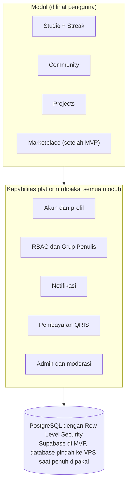

## 7. Struktur Keseluruhan Aplikasi

Aplikasi terdiri dari tiga modul inti (Studio dengan Streak di dalamnya, Community, dan Projects), ditambah Marketplace setelah MVP, di atas satu lapisan kapabilitas platform dan satu basis data. Aplikasi dibangun sebagai satu proyek Next.js; basis data memakai Supabase di MVP dan dipindah ke VPS saat sudah penuh dipakai.

Modul menjadi lapisan produk yang dilihat pengguna; kapabilitas platform melayani semua modul; seluruh data berada di satu PostgreSQL dengan Row Level Security.

**Pembagian peran lapisan.**

| Lapisan | Isi | Aturan |
| --- | --- | --- |
| Modul | Ranah Studio (termasuk Streak), Ranah Community, Projects; Marketplace setelah MVP | Tiga modul inti di MVP; Marketplace menyusul. Modul lain tidak ditambah tanpa persetujuan founder |
| Kapabilitas platform | Akun dan profil, RBAC dan Grup Penulis, notifikasi, pembayaran, admin dan moderasi | Dipakai bersama; bukan modul dan tidak muncul sebagai produk tersendiri |
| Data dan penyimpanan | PostgreSQL, Auth, Storage di Supabase (MVP); setelah migrasi hanya PostgreSQL yang pindah ke VPS, login tetap di Supabase Auth (bagian 19.3) | Skema modular per domain, tetapi satu identitas pengguna dan relasi lintas modul |

**Prinsip arsitektur.**

- **Modular:** setiap modul memiliki domain data dan logikanya sendiri, berkomunikasi lewat antarmuka dan peristiwa yang jelas (bagian 19).
- **Satu identitas:** semua modul memakai akun dan profil yang sama.
- **Hak akses di basis data:** aturan RBAC, termasuk izin Grup Penulis, ditegakkan lewat Row Level Security, bukan hanya di antarmuka.
- **Monolith:** tampilan dan backend berada dalam satu proyek Next.js dan satu deploy, supaya mudah dirawat tim kecil. Dipecah hanya bila memang diperlukan.
- **Mudah dipindah:** akses data lewat satu lapisan di server, skema lewat berkas migrasi, serta penyimpanan file lewat lapisan tipis (login tetap di Supabase Auth), supaya database dapat dipindah dari Supabase ke VPS tanpa menulis ulang fitur (bagian 19.3).
- **Teknologi:** Next.js, TypeScript, Tailwind CSS, shadcn/ui, dan Supabase untuk MVP, sesuai keputusan founder. Rincian skema dan pustaka pendukung ditentukan pada fase desain teknis.
