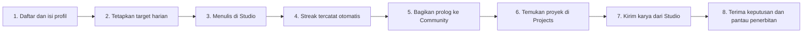
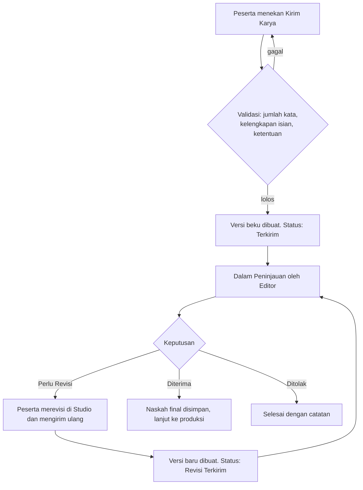

## 13. User Flows

Empat alur berikut menjadi acuan desain dan pengujian: perjalanan inti lintas modul, pengiriman karya ke Antologi, lalu alur Solo, Kelas Menulis, dan Lomba.

### 13.1 Perjalanan inti penulis

Satu karya berpindah dari Studio ke Streak, Community, dan Projects tanpa ditulis ulang.

### 13.2 Pengiriman dan revisi karya Antologi

Submission yang gagal validasi kembali ke peserta tanpa membuat versi; setelah terkirim, setiap revisi menghasilkan versi baru dan masuk lagi ke peninjauan.

### 13.3 Alur Solo

1. Penulis membuka daftar paket, membandingkan layanan, harga (IDR atau MYR), dan persyaratan naskah.
2. Penulis memilih paket, menyetujui ketentuan hak cipta, dan mengisi pengajuan (jenis buku, sinopsis, naskah dari Studio atau unggahan).
3. Pembayaran dikonfirmasi (manual di MVP).
4. Tim penerbitan meninjau kelayakan naskah lalu menyetujui atau meminta perbaikan.
5. Dasbor menampilkan tahap: editing, proofreading, desain cover, layout, persetujuan final, produksi.
6. Pada persetujuan final, penulis menyetujui atau meminta perubahan. Setelah produksi dimulai, perubahan mengikuti kebijakan (Q-24).
7. Buku selesai diproduksi; status terakhir dicatat.

### 13.4 Alur Kelas Menulis

1. Peserta melihat daftar kelas, kurikulum, profil pengajar, jadwal, dan biaya.
2. Peserta mendaftar dan membayar; pendaftaran aktif setelah konfirmasi.
3. Peserta membuka dasbor kelas: jadwal, materi, tugas.
4. Peserta menulis tugas di Studio dan mengumpulkannya (versi beku) sebelum deadline.
5. Mentor memberi feedback dan status tugas.
6. Progres belajar bertambah; peserta yang memenuhi syarat menerima sertifikat (Fase 2).

### 13.5 Alur Lomba

1. Peserta melihat tema, persyaratan, hadiah, kriteria, dan deadline, lalu mendaftar (dan membayar bila berbayar).
2. Peserta mengirim karya dari Studio sebelum deadline; sistem membuat versi beku.
3. Setelah pendaftaran ditutup, Organizer menugaskan juri. Pada lomba anonim, identitas peserta disembunyikan.
4. Juri menilai tiap karya per kriteria dan mengirim penilaian. Setelah penilaian ditutup, skor tidak dapat diubah.
5. Organizer menetapkan finalis dan pemenang, lalu mengumumkannya. Peserta diberi tahu.
