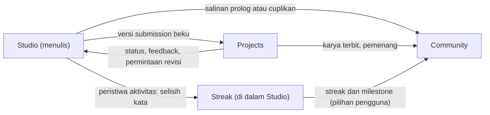

## 18. Hubungan Antar Modul

Integrasi antarmodul adalah bagian inti produk, bukan tambahan: karya yang ditulis sekali di Studio dipakai oleh Streak, Community, dan Projects tanpa disalin ulang oleh pengguna.

Studio mengirim data ke Streak (di dalam Studio), Community, dan Projects; Projects mengirim status kembali ke Studio, dan Streak serta Projects memberi data tambahan ke profil di Community.

### 18.1 Aturan data lintas modul

| Aliran | Apa yang dikirim | Aturan yang harus dijaga |
| --- | --- | --- |
| Studio ke Streak | Peristiwa aktivitas: pengenal unik, dokumen, kata ditambahkan, kata dihapus, waktu | Berbasis selisih; pengiriman ulang tidak menggandakan; tanggal lokal menurut zona waktu pengguna |
| Studio ke Community | Salinan prolog atau cuplikan (judul, isi, genre) dengan referensi ke dokumen asal | Dokumen pribadi tidak otomatis publik; pembaruan karya publik adalah tindakan sadar penulis |
| Studio ke Projects | Versi submission beku (isi, jumlah kata, hash, waktu) dengan referensi ke dokumen asal | Tidak berubah ketika dokumen asal diedit; revisi membuat versi baru |
| Projects ke Studio | Status submission, feedback, permintaan revisi | Terlihat di daftar dokumen dan tombol Revisi membuka dokumen asal |
| Projects ke Community | Karya terbit, pemenang, finalis tampil di profil dan portofolio | Hanya dengan persetujuan pengguna |
| Streak ke Community | Streak dan milestone tampil di profil | Pilihan pengguna; default privat (Q-45) |

### 18.2 Contoh perjalanan ujung ke ujung

1. Dewi mendaftar, melengkapi profil, dan menetapkan target 300 kata per hari.
2. Di Studio ia menulis puisi 120 kata; Studio menyimpan otomatis dan mengirim selisih kata ke Streak.
3. Total harian Dewi mencapai 320 kata, sehingga hari itu selesai dan streak menjadi 7.
4. Dewi memilih prolog tiga baris dari puisinya dan membagikannya ke Community sebagai postingan publik; sistem membuat salinan publik dari teks itu saja. Dokumen aslinya tetap pribadi.
5. Pembaca memberi 48 Apresiasi dan satu komentar; Dewi mendapat notifikasi.
6. Dari Discover, Dewi melihat Antologi "Surat yang Tidak Pernah Terkirim", membaca ketentuan hak cipta, dan mendaftar.
7. Ia memilih dokumen dari Studio untuk dikirim. Sistem membuat versi beku. Dewi tetap menyunting dokumen aslinya tanpa memengaruhi submission.
8. Editor meminta revisi; Dewi merevisi di Studio dan mengirim versi baru.
9. Karya Diterima dan Dewi memantau tahap penyuntingan, layout, dan produksi di dasbornya. Karyanya muncul di profil Community setelah buku terbit.
